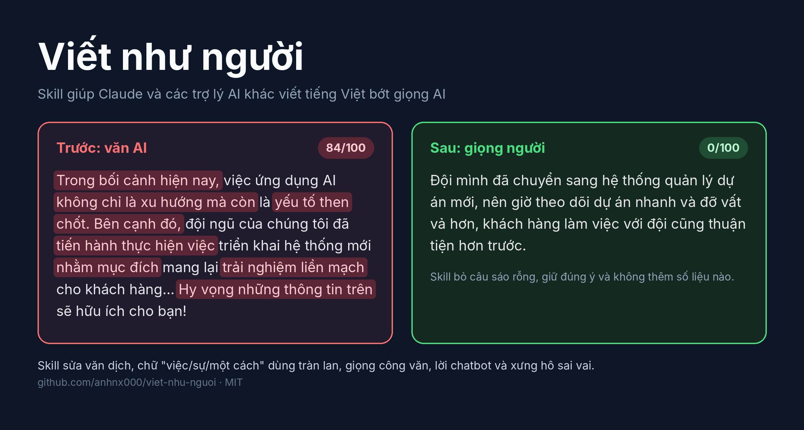
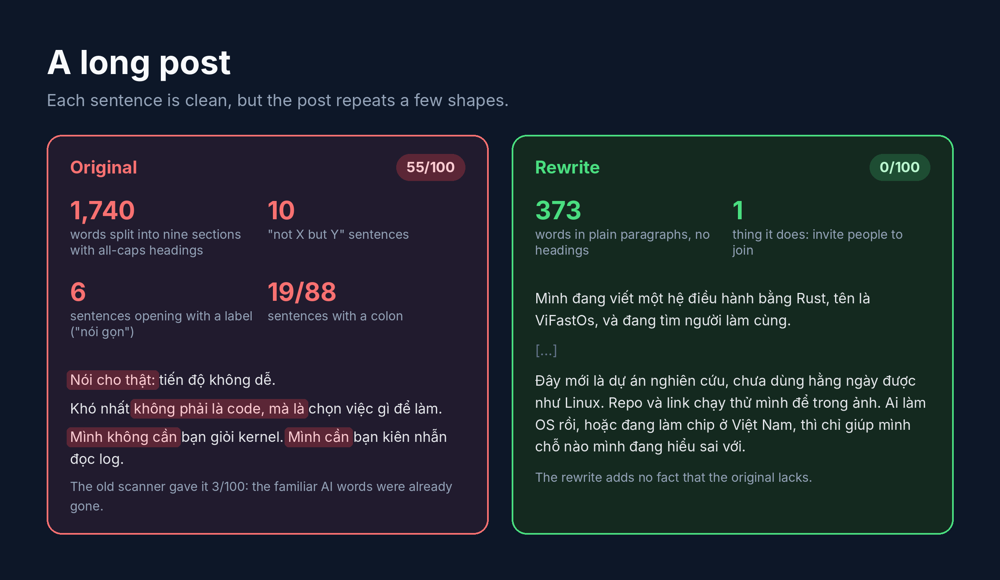

# Viết như người · Vietnamese Humanizer

**Human voice for Vietnamese (chống giọng văn AI). Let AI draft it, and still sound like you.**

[](https://github.com/anhnx000/viet-nhu-nguoi/actions/workflows/test.yml)
[](LICENSE)

[Tiếng Việt](README.md) · **English**



AI drafts slides, emails and reports quickly, and Vietnamese readers spot the result just as quickly. The slide titles say "Tổng quan" (*Overview*) and "Thách thức" (*Challenges*). The email opens with "Trong bối cảnh hiện nay" (*in today's context*) and closes with "Hy vọng thông tin trên hữu ích!" (*Hope this helps!*). Fine for a team chat. For your boss or a customer, you end up rewriting it by hand.

Viết như người ("write like a person") is a skill (an add-on pack of instructions) for Claude and other AI assistants. Once installed, the assistant writes Vietnamese more like a working person does. Slide titles state the conclusion, emails use the right pronouns of address, sentences aren't padded, and the numbers you gave are left alone. The skill is free and open source.

English works too, based on Wikipedia's [Signs of AI writing](https://en.wikipedia.org/wiki/Wikipedia:Signs_of_AI_writing) and [blader/humanizer](https://github.com/blader/humanizer). Most of the work went into Vietnamese, because generic humanizers miss what makes Vietnamese AI text sound off: it reads like it was written in English and translated.

**Contents:** [Install, no coding needed](#install-in-a-few-minutes-no-coding-needed) · [Everyday use](#everyday-use) · [Before and after](#before-and-after) · [What the skill fixes](#what-the-skill-fixes) · [Command line](#for-command-line-users)

## What people use it for

- Building report and proposal decks. Every title is a conclusion, so your manager can skim the titles and know what to decide. Missing numbers are marked `[cần xác nhận]` (*to confirm*), never made up.
- Writing emails to a boss or a customer. The email leads with the request, uses the right pronouns of address (anh/chị/em, quý khách) and never switches to a default "bạn".
- Fixing reports and documents translated from English. The skill removes calqued sentences such as "được... bởi" (*was ... by*), "Điều này cho phép" (*This allows*) and "thông qua việc" (*through the act of*).
- Writing Facebook, LinkedIn and blog posts. AI drafts, the voice stays yours, and each post tells just one story.
- Checking before you send. The skill points at the places that sound like AI, and you decide what to change.

## Install in a few minutes, no coding needed

You don't type any commands. You ask your AI assistant to install it, the way you would ask a colleague from IT.

**Step 1. Open an AI assistant that runs on your computer.** For example the Claude Code desktop app, which you use with a mouse like any other program. Codex, Cursor, Gemini CLI and OpenCode work too. Claude or ChatGPT opened in a browser cannot install anything on your machine.

**Step 2. Paste this into the chat box:**

> Install the viet-nhu-nguoi skill for me from https://github.com/anhnx000/viet-nhu-nguoi

**Step 3. Click approve** when the assistant asks permission to download and install. It usually takes under a minute.

**Step 4. Start a new conversation and try it:**

> Viết như người: soạn giúp tôi email xin sếp lùi hạn nộp báo cáo 3 ngày, xưng em

(*"Write like a person: draft an email asking my boss for three more days on the report; I address myself as em."*) If the email comes back short, gets to the request at once and keeps "em" all the way through, the skill is working.

Whatever you need later, you also just say it to the assistant.

| You want to | You type |
| --- | --- |
| Check it is installed | "Do I have the viet-nhu-nguoi skill installed?" |
| Get the latest version | "Update the viet-nhu-nguoi skill to the latest version" |
| Remove it | "Uninstall the viet-nhu-nguoi skill" |

If the assistant reports an error while installing, take a screenshot and [open an issue](https://github.com/anhnx000/viet-nhu-nguoi/issues) (the project's bug-report page). I'll take a look.

<details>
<summary>For an AI assistant that was asked to install this skill</summary>

The user is not technical, so do all of it yourself and only ask for permission to run commands. Try these in order and stop at the first that works:

1. `npx` is available: run `npx skills add anhnx000/viet-nhu-nguoi -g -y`.
2. `git` and `bash` are available (macOS, Linux, WSL): `git clone https://github.com/anhnx000/viet-nhu-nguoi.git ~/viet-nhu-nguoi && bash ~/viet-nhu-nguoi/install.sh --copy`.
3. Windows without bash, or no git: download `https://github.com/anhnx000/viet-nhu-nguoi/archive/refs/heads/main.zip`, unzip it, and copy the `skills/viet-nhu-nguoi` folder into the agent's user-level skills folder (Claude Code: `~/.claude/skills/viet-nhu-nguoi`, which on Windows is `%USERPROFILE%\.claude\skills\viet-nhu-nguoi`).

Afterwards, check that `SKILL.md` sits in the target folder, tell the user where it was installed, and suggest a new conversation if the skill does not show up. To update, repeat the method you used. For method 2, run `git -C ~/viet-nhu-nguoi pull` and then `bash ~/viet-nhu-nguoi/install.sh --copy --update`. For method 3, delete the old folder before copying the new one. To uninstall, delete the `viet-nhu-nguoi` folder from the skills folder.

</details>

<details>
<summary>For people comfortable with a terminal: install by hand</summary>

As a plugin, inside Claude Code:

```text
/plugin marketplace add anhnx000/viet-nhu-nguoi
/plugin install viet-nhu-nguoi@viet-nhu-nguoi
```

Or clone and run the script. It symlinks the skill into `~/.claude/skills/`, so `git pull` updates it:

```bash
git clone https://github.com/anhnx000/viet-nhu-nguoi.git
cd viet-nhu-nguoi
bash install.sh                   # symlink
bash install.sh --copy            # or copy, if you want to review each update before installing
bash install.sh --copy --update   # replace an installed copy with the new version
```

Other agents (Cursor, Codex, Gemini CLI, OpenCode and more) can use the [skills](https://github.com/vercel-labs/skills) CLI:

```bash
npx skills add anhnx000/viet-nhu-nguoi      # current project only
npx skills add anhnx000/viet-nhu-nguoi -g   # every project (user level)
```

The command asks which agents to install for. Pass `-a claude-code` (or `-a '*'`) and `-y` to skip the prompts. The skill is only Markdown files, so it runs on whatever model your editor uses.

</details>

## Everyday use

Talk to it the way you would brief a colleague. There is no syntax to remember.

| You type | What the skill does |
| --- | --- |
| "Làm slide báo cáo tiến độ dự án tuần này để sếp duyệt" (*make this week's progress deck for my boss to approve*) | Asks who is watching, what they must decide, and whether it is presented live or sent to read, then builds the deck |
| "Sửa file bao-cao-q3.pptx cho bớt giọng AI" (*make this deck sound less like AI*) | Reads the text and speaker notes on every slide, fixes titles, bullets and notes |
| "Viết email xin sếp lùi deadline 3 ngày, xưng em" (*email my boss for a three-day extension*) | Writes a short email, request first, with "em"/"anh" kept consistent throughout |
| "Viết bài Facebook kể về dự án của mình, khoảng 300 chữ" (*a 300-word Facebook post about my project*) | Asks you for one or two things that really happened, then tells one story. No section headings, no background lecture |
| "Soi giúp đoạn này chỗ nào giọng AI" (*where does this sound like AI?*) | Lists each spot with the reason and a suggested fix, and rewrites nothing |
| Paste an email you wrote yourself | Picks up your sentence rhythm, connectives and pronouns of address, then writes to match |

For better results:

1. Say who will read it and who you are to them. "To my department head, I'm em" produces a different email from "to a customer, we are chúng tôi".
2. Paste a passage you wrote yourself, the same kind of text as the one you need. The skill copies your sentence length and the words you favour.
3. Give it the real numbers, names and dates. If something is missing the skill asks or leaves a blank, and it does not make things up.
4. When a phrase feels off, say "mình không nói thế" (*I don't talk like that*). The skill adjusts and remembers for the rest of the conversation.

Other ways to use it:

- Type `/viet-nhu-nguoi` to turn it on for the whole conversation. Every reply then follows the rules, short ones included.
- The skill turns itself on when you ask for an email, message or post that you will send under your name.
- You can pick a voice by name: *đời thường* (casual), *công việc* (work), *kỹ thuật* (technical), *ấm áp* (warm), *thẳng* (blunt). The voice changes style only, while pronouns of address and content stay put.
- Text you wrote yourself only gets a light edit.
- For an important deck, the skill has another AI assistant, one that knows nothing about the context, read it and score it on seven criteria out of 70. The skill then puts the feedback in a table so you can accept or reject each item.

## Before and after

The scores below come from the scanner bundled with the skill, on a 0-100 scale. The higher the score, the more template habits the text has.

### Slides

The [`examples/`](examples) folder has two sample decks, one made by AI and one made with the skill. These are their titles:


*AI deck: "Digital transformation: a journey of value creation; Overview; Challenges; 3 pillars of the solution; Benefits; Conclusion; Thank you." Skill deck: "Proposal: hire one more QA for Q1 2027; both Q3 releases slipped because we lacked testers; one QA costs less than the penalty for each delay; please approve by 30/11 so we can hire in time."*

The four titles of the second deck are enough to follow the whole proposal. The scanner gives it 0/100 and the first deck 48/100.

### Emails and reports


*AI draft, roughly: "In today's context, applying AI is not only a trend but also a key factor that elevates business performance. This is proven by many studies showing productivity can increase significantly. In addition, our team proceeded to carry out the deployment of a new system for the purpose of delivering a seamless experience. It makes project management easier, faster and more efficient. Hope this helps!"*

*After the skill: "Our team has moved to the new project management system, so tracking projects is now faster and less work, and customers find it easier to work with us." With details: "Since March we track projects in the new system. Customers check progress themselves instead of messaging us, and the team saves about half a day of reporting each week."*

The AI draft scores 84/100 with 17 tells, the parts marked red in the image. The version after the skill is short because the skill does not invent numbers. If you want detail, the skill asks you and writes with only what you gave it, as in the third version. Both rewrites score 0/100. The three texts are in [`examples/truoc.md`](examples/truoc.md), [`examples/sau.md`](examples/sau.md) and [`examples/sau-co-chi-tiet.md`](examples/sau-co-chi-tiet.md).

### A long post

Version 2.2 of the skill came out of a real post. [The original](examples/bai-dang-truoc.md) runs 1,740 Vietnamese words under nine all-caps headings. Most of the familiar AI vocabulary was already gone, so the previous scanner scored it 3/100. Readers still spotted it at once, because the whole post keeps repeating a few sentence shapes.



*The three quoted lines: "To be honest: progress isn't easy." "The hardest part isn't the code, it's choosing what to work on." "I don't need you to be good at kernels. I need you to be patient with logs."*

Since version 2.2 the scanner counts across the whole text, so this post scores 55/100. It has ten "not X but Y" sentences, six sentences that open with a label such as "nói gọn" (*put briefly*) or "nói cho thật" (*to be honest*), and a colon in 19 of 88 sentences.

[The rewrite](examples/bai-dang-sau.md) is 373 words and does one job, inviting people to join the project. The scanner gives it 0/100, and it adds no fact that the original lacks. The operating-system primer, the microkernel history and the security statistics are left for other posts.

## What the skill fixes

The skill has a catalog of 62 AI-writing patterns, each with a before and after example ([full list](skills/viet-nhu-nguoi/references/patterns.md), in Vietnamese). The Vietnamese-only group includes these easy-to-spot patterns:

| Pattern | Example | Becomes |
| --- | --- | --- |
| Calqued passive | được phát triển bởi Google (*was developed by Google*) | Google phát triển (*Google developed*) |
| "This" / "It" openers | Điều này cho phép người dùng... (*This allows users to...*) | name the thing, or drop the subject |
| Nominalisation | Việc áp dụng AI giúp việc quản lý trở nên dễ dàng | Dùng AI thì quản lý dễ hơn |
| Empty verbs | tiến hành thực hiện việc rà soát (*proceed to carry out a review*) | rà soát (*review*) |
| Literal marketing calques | mở khóa tiềm năng (*unlock potential*), trải nghiệm liền mạch (*seamless experience*) | say what it actually does |
| Chains of "của" (*of*) | sự nâng cao của năng suất của nhân viên | nhân viên làm được nhiều hơn |
| Redundant pairs | hiện nay đang trong quá trình (*currently now in the process of*) | đang (*is*) |
| Pronouns of address | "bạn" all the way through a message to your boss; mixing "bạn" and "quý vị" | one pair that fits the relationship |
| English glosses in brackets | hiệu suất (performance) | hiệu suất |

Harder to spot is word-for-word translation: every word is Vietnamese, but the sentence still follows English. It tends to show in these places:

- "bạn" (*you*) opens every sentence and "của bạn" (*your*) follows every noun;
- "một" (*a*), "các", "những" (plural markers) stand in front of every noun;
- passives that never say who acted ("số liệu được giữ nguyên", *the figures are kept*), and objects as grammatical subjects ("Bảng này cho thấy", *This table shows*);
- "đã", "đang", "sẽ" (tense markers) and "có thể" (*can*) scattered everywhere;
- sentences that open with "Với..." (*With/For...*) or "Để..., bạn cần..." (*To..., you need...*), and "và" (*and*) joining every clause;
- idioms and headings translated literally ("tin tốt là", *the good news is*; "Bắt đầu nhanh", *Quick start*).

For text like this the skill rewrites from the idea, the way Vietnamese speakers would say it, instead of swapping phrases one by one.

Some patterns only show when you read the whole text, even after each sentence is fine:

- sentences that open with a label ("nói gọn", "nói cho thật:");
- the "not X but Y" shape used three times or more;
- every paragraph closing on a line that sounds like a proverb;
- colons everywhere;
- the filler words of translated text ("một", "các", "được", "sẽ", "của bạn", the leftovers of English articles, plurals, tenses and possessives) thick across the whole text;
- full stops that chop one thought into several short sentences, or the reverse, one sentence joined from too many clauses;
- a long post that covers every topic.

Slides and long documents have their own group. The skill catches titles that are only labels ("Tổng quan", "Kết luận"), titles that count points ("3 trụ cột", *3 pillars*), exactly three bullets on every slide, empty promises ("chi tiết sẽ trao đổi sau", *details to be discussed later*) and speaker notes that read like a memo. The slide-writing guide is in [references/slides.md](skills/viet-nhu-nguoi/references/slides.md) (in Vietnamese).

The remaining groups apply to both Vietnamese and English: false contrasts, one-line punchlines, lists forced to three items, em dashes, inflated significance, vague authorities, decorative bold and emoji, chatbot filler, and re-explaining what the reader already knows.

There are also things the skill does not touch: regional dialect, colloquial speech, Sino-Vietnamese terms used correctly, passives in technical docs, and small words whose removal changes the meaning ("vẫn" *still*, "chưa" *not yet*, "chỉ" *only*, "có thể" *may*).

## For command-line users

The repo has two scripts you can run by hand. Both use only the Python standard library.

`scan.py` scores a `.md`, `.txt` or `.pptx` file and prints a 0-100 score with every match:

```bash
python3 -I skills/viet-nhu-nguoi/scripts/scan.py file.md
```

| Option | Effect |
| --- | --- |
| `--json` | machine-readable output |
| `--max 30` | exit 1 when the score is above 30, for CI or a pre-commit hook |
| `--meta` | skip quoted material (`>` lines, tables, text in double quotes), for documents that discuss the patterns themselves |
| `--titles` | print only the headings or slide titles, in order |
| `--text` | dump every slide's text and notes from a `.pptx` |

`check_facts.py` compares an original with its rewrite (two `.pptx` files work too). It fails if a number, date, time, link or code span was lost or added, and warns about missing proper names:

```bash
python3 -I skills/viet-nhu-nguoi/scripts/check_facts.py original.md rewrite.md
```

Output for two of the sample files:

```text
$ python3 -I skills/viet-nhu-nguoi/scripts/scan.py examples/truoc.md
Điểm 84/100 (dày đặc): 17 dấu hiệu trong 5 dòng, 110 chữ.
[từ vựng AI (vi)] 3      nâng tầm, trong bối cảnh hiện nay, bên cạnh đó
[động từ rỗng (vi)] 3    tiến hành thực hiện, thực hiện việc, nhằm mục đích
[văn dịch (vi)] 2        được chứng minh bởi, trải nghiệm liền mạch
[danh hóa (vi)] 2        một cách đáng..., trở nên dễ...
["Điều này"/"Nó" mở câu] 2
[đối lập giả] 1          không chỉ là xu hướng mà còn
[thổi phồng] 1           yếu tố then chốt
[uy tín mơ hồ] 1         nhiều nghiên cứu chỉ ra
[lời chatbot] 1          hy vọng những thông tin trên
[chữ đệm dịch dày] 1     145 chữ đệm trên 1.000 chữ

$ python3 -I skills/viet-nhu-nguoi/scripts/scan.py examples/slide-truoc.pptx
Điểm 48/100 (nhiều dấu hiệu): 21 dấu hiệu trong 7 slide, 176 chữ.
[từ vựng AI (vi)] 7
[tiêu đề dạng nhãn] 4        slide 2: Tổng quan, slide 3: Thách thức, slide 5: Lợi ích, slide 6: Kết luận
[hứa suông] 1                slide 5, ghi chú: chi tiết sẽ được trao đổi sau
[tiêu đề đếm số ý] 1         slide 4: 3 trụ cột giải pháp
[câu khó nói (ghi chú)] 1    slide 2, ghi chú: Như chúng ta có thể thấy, ...
[số gạch đầu dòng đều] 1     5/5 slide có đúng 3 ý
...
```

## Good to know

The skill does not send your text anywhere new. The text only goes to the AI model your assistant already uses. The skill itself is Markdown files plus a few Python scripts that use only the standard library, with no network calls, no data collection and no account.

The score is only a guide. It tells you how many template habits a text has and whether its sentences are too uniform, and it cannot tell you whether AI wrote the text. Some people write in a uniform rhythm, and AI detectors are known to misfire on people writing in a second language. Treat a high score as a list of places to reread.

The skill makes text more natural and easier to read. It does not promise to get past AI detectors and does not use evasion tricks such as deliberate typos or hidden characters. Please don't use it to do a student's coursework for them or to impersonate anyone, and don't use the pattern list to conclude that someone used AI. People guessing by feel do only a little better than chance.

## What's in the repo

```text
skills/viet-nhu-nguoi/
├── SKILL.md                 main rules, loaded by Claude when invoked
├── references/patterns.md   62 patterns with before/after examples
├── references/slides.md     slides, speaker notes, fresh-reader test
├── references/sources.md    references: articles, research, style guides, other skills
├── scripts/scan.py          scanner with a 0-100 score, no third-party packages
├── scripts/check_facts.py   checks a rewrite kept numbers, dates, times, links, code
├── scripts/slides.py        reads slide text and notes from .pptx, standard library only
└── LICENSE-humanizer        MIT license of blader/humanizer
assets/                      banner, example images and the script that redraws them (make_images.py)
examples/                    before/after text and .pptx decks used in the README and tests
tests/test_scan.py           python3 -m unittest discover -s tests
```

## Contributing

If you find a Vietnamese AI phrasing the skill misses, or a natural sentence it spoils, open an issue with the sentence and the version you think is right. Pull requests that add a pattern need a before/after example and a test in `tests/test_scan.py`, including a case that must not be flagged.

## Credits

- Wikipedia: [Signs of AI writing](https://en.wikipedia.org/wiki/Wikipedia:Signs_of_AI_writing) (WikiProject AI Cleanup).
- [blader/humanizer](https://github.com/blader/humanizer), MIT, Copyright (c) 2025 Siqi Chen. The pattern catalog structure is based on it.
- Open-source Vietnamese humanize skills (MIT), used for cross-checking the catalog, while the text here is written independently: [longhang2004/vietnamese-humanizer](https://github.com/longhang2004/vietnamese-humanizer), [andyluu98/vn-humanize](https://github.com/andyluu98/vn-humanize), [cuongducle/viet-humanize](https://github.com/cuongducle/viet-humanize), [pdh372/humanize-vietnamese](https://github.com/pdh372/humanize-vietnamese).
- The slide guidance borrows ideas, rewritten in our own words, from [carnot-tech/jinba-consulting-pptx-skill](https://github.com/carnot-tech/jinba-consulting-pptx-skill) (MIT), [zarazhangrui/frontend-slides](https://github.com/zarazhangrui/frontend-slides) (MIT) and the `doc-coauthoring` skill in [anthropics/skills](https://github.com/anthropics/skills) (Apache 2.0).
- [references/sources.md](skills/viet-nhu-nguoi/references/sources.md) (in Vietnamese) lists every source: articles, books and research on Vietnamese, research on detector reliability, style guides and other skills. It marks which ones the skill builds on directly.

MIT licensed.
