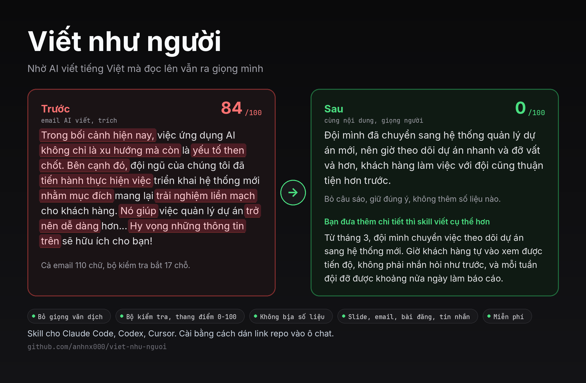
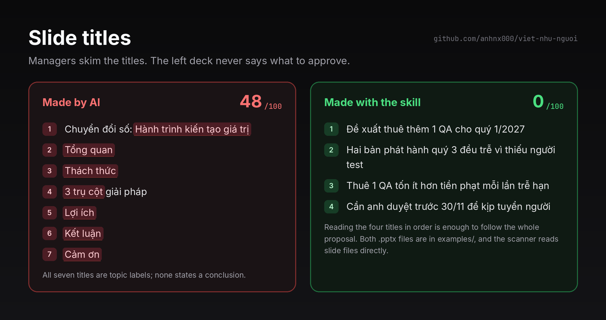
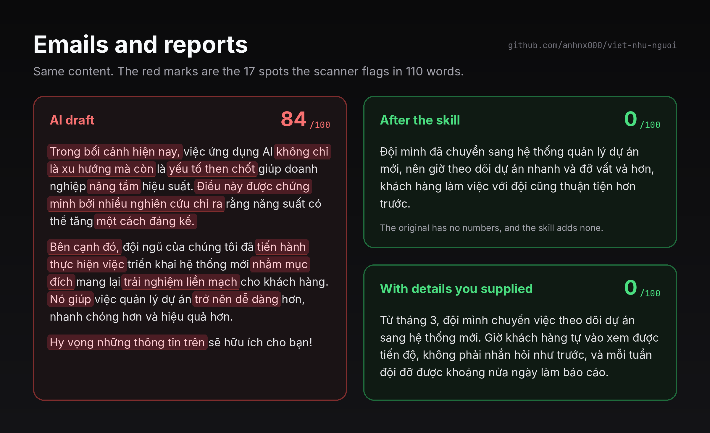
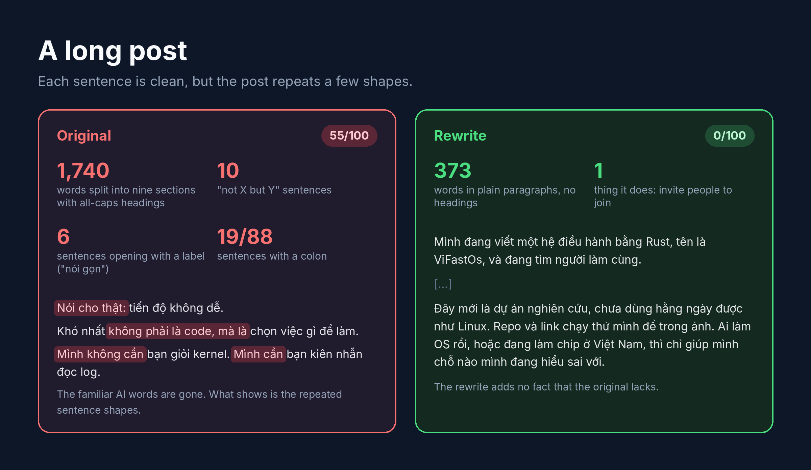
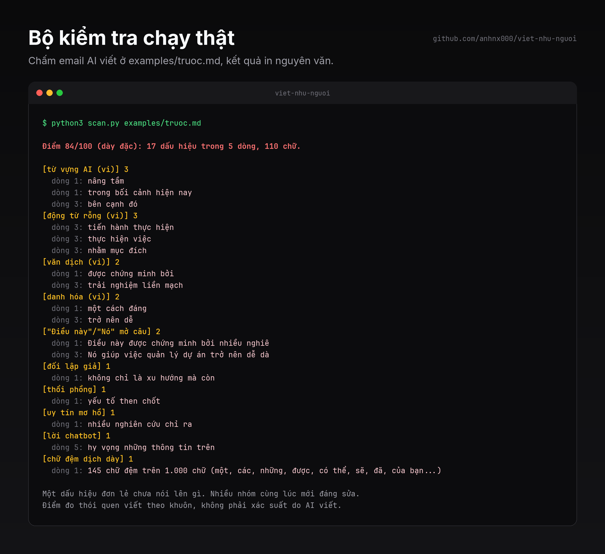

# Viết như người · Vietnamese Humanizer

Human voice for Vietnamese (chống giọng văn AI): let AI draft it and still sound like you.

[](https://github.com/anhnx000/viet-nhu-nguoi/actions/workflows/test.yml)
[](LICENSE)

[Tiếng Việt](README.md) · **English**



AI drafts slides, emails and reports quickly, and Vietnamese readers spot the result just as quickly. Every deck has "Tổng quan" (*Overview*) and "Thách thức" (*Challenges*), and the email opens with "Trong bối cảnh hiện nay" (*in today's context*) and closes with "Hy vọng thông tin trên hữu ích!" (*Hope this helps!*). Before it goes to a boss or a customer, someone rewrites it by hand.

Viết như người ("write like a person") is a skill, an add-on pack of instructions for Claude Code, Codex, Cursor and other AI assistants. Once installed, slide titles state the conclusion, emails use the right pronouns of address, sentences aren't padded, and your numbers are left alone. Free and open source.

The skill is written for Vietnamese. It builds on Wikipedia's [Signs of AI writing](https://en.wikipedia.org/wiki/Wikipedia:Signs_of_AI_writing) and [blader/humanizer](https://github.com/blader/humanizer), and English text still gets the structural rules, but there is no English-specific section. The work went into Vietnamese because generic humanizers miss what makes Vietnamese AI text sound off: it reads like English that was translated word by word.

Contents: [Install](#install) · [Usage](#usage) · [Before and after](#before-and-after) · [Signs of AI writing](#signs-of-ai-writing) · [Scanner and fact checker](#scanner-and-fact-checker)

## Use cases

- Report and proposal decks: every title is a conclusion, so a manager can skim the titles and know what to decide. Missing numbers are marked `[cần xác nhận]` (*to confirm*) for you to fill in.
- Emails to a boss or a customer: request first, the right pair of pronouns (anh/chị/em, quý khách), never a default "bạn".
- Documents translated from English: calqued sentences such as "được... bởi" (*was ... by*) and "Điều này cho phép" (*This allows*) are rewritten.
- Facebook, LinkedIn and blog posts: AI drafts, the voice stays yours, one story per post.
- Chat replies in your voice: forms of address, abbreviations and laugh style come from messages you sent to that same person. Within one group chat, a close friend gets the casual voice and a boss or an older colleague gets the polite one.
- A check before sending: the skill points at what sounds like AI, and you decide what to change.

## Install

You don't type any commands. You ask your AI assistant to install it, the way you would ask a colleague from IT.

1. Open an AI assistant that runs on your computer, for example the Claude Code desktop app, which you use with a mouse like any other program. Codex, Cursor, Gemini CLI and OpenCode work too. Claude or ChatGPT opened in a browser cannot install anything on your machine.
2. Paste this into the chat box:

   > Install the viet-nhu-nguoi skill for me from https://github.com/anhnx000/viet-nhu-nguoi

3. Click approve when the assistant asks permission to download and install. It usually takes under a minute.
4. Start a new conversation and try it:

   > Viết như người: soạn giúp tôi email xin sếp lùi hạn nộp báo cáo 3 ngày, xưng em

(*"Write like a person: draft an email asking my boss for three more days on the report; I address myself as em."*) If the email comes back short, gets to the request at once and keeps "em" all the way through, the skill is working.

To check, update or remove it, ask the assistant the same way: "Do I have the viet-nhu-nguoi skill installed?", "Update the viet-nhu-nguoi skill", "Uninstall the viet-nhu-nguoi skill". If installing fails, take a screenshot and [open an issue](https://github.com/anhnx000/viet-nhu-nguoi/issues).

<details>
<summary>Instructions for an AI assistant installing the skill</summary>

The user is not technical, so do all of it yourself and only ask for permission to run commands. Try these in order and stop at the first that works:

1. `npx` is available: run `npx skills add anhnx000/viet-nhu-nguoi -g -y`.
2. `git` and `bash` are available (macOS, Linux, WSL): `git clone https://github.com/anhnx000/viet-nhu-nguoi.git ~/viet-nhu-nguoi && bash ~/viet-nhu-nguoi/install.sh --copy`.
3. Windows without bash, or no git: download `https://github.com/anhnx000/viet-nhu-nguoi/archive/refs/heads/main.zip`, unzip it, and copy the `skills/viet-nhu-nguoi` folder into the agent's user-level skills folder (Claude Code: `~/.claude/skills/viet-nhu-nguoi`, which on Windows is `%USERPROFILE%\.claude\skills\viet-nhu-nguoi`).

Afterwards, check that `SKILL.md` sits in the target folder, tell the user where it was installed, and suggest a new conversation if the skill does not show up. To update, repeat the method you used. For method 2, run `git -C ~/viet-nhu-nguoi pull` and then `bash ~/viet-nhu-nguoi/install.sh --copy --update`. For method 3, delete the old folder before copying the new one. To uninstall, delete the `viet-nhu-nguoi` folder from the skills folder.

</details>

<details>
<summary>Install by hand with plugin, git or npx</summary>

As a plugin, inside Claude Code:

```text
/plugin marketplace add anhnx000/viet-nhu-nguoi
/plugin install viet-nhu-nguoi@viet-nhu-nguoi
```

Or clone and run the script. It symlinks the skill into `~/.claude/skills/`, so `git pull` updates it:

```bash
git clone https://github.com/anhnx000/viet-nhu-nguoi.git
cd viet-nhu-nguoi
bash install.sh                   # symlink
bash install.sh --copy            # or copy, if you want to review each update before installing
bash install.sh --copy --update   # replace an installed copy with the new version
```

If you cloned before 16 November 2026, `git pull` will fail because the history was squashed. Run `git fetch origin && git reset --hard origin/main` once; it discards local edits in that folder.

Other agents (Cursor, Codex, Gemini CLI, OpenCode and more) can use the [skills](https://github.com/vercel-labs/skills) CLI:

```bash
npx skills add anhnx000/viet-nhu-nguoi      # current project only
npx skills add anhnx000/viet-nhu-nguoi -g   # every project (user level)
```

The command asks which agents to install for. Pass `-a claude-code` (or `-a '*'`) and `-y` to skip the prompts. The skill is only Markdown files, so it runs on whatever model your editor uses.

</details>

## Usage

Talk to it the way you would brief a colleague. There is no syntax to remember.

| You type | What the skill does |
| --- | --- |
| "Làm slide báo cáo tiến độ dự án tuần này để sếp duyệt" (*make this week's progress deck for my boss to approve*) | Asks who is watching, what they must decide, and whether it is presented live or sent to read, then builds the deck |
| "Sửa file bao-cao-q3.pptx cho bớt giọng AI" (*make this deck sound less like AI*) | Reads the text and speaker notes on every slide, fixes titles, bullets and notes |
| "Viết email xin sếp lùi deadline 3 ngày, xưng em" (*email my boss for a three-day extension*) | Writes a short email, request first, with "em"/"anh" kept consistent throughout |
| "Viết bài Facebook kể về dự án của mình, khoảng 300 chữ" (*a 300-word Facebook post about my project*) | Asks for one or two things that really happened, then tells one story, with no section headings |
| "Soi giúp đoạn này chỗ nào giọng AI" (*where does this sound like AI?*) | Lists each spot with the reason and a suggested fix, and rewrites nothing |
| "Rep giúp mình tin anh Khải trong nhóm này" (*reply to Khải in this group for me*) plus the chat log | Replies in the voice you use with Khải, even if you joke around with others in the same group |

For closer results, say who will read it and who you are to them: "to my department head, I'm em" produces a different email from "to a customer, we are chúng tôi". Paste a passage you wrote yourself and the skill picks up your sentence rhythm and favourite words. Give it the real numbers, names and dates, and it asks about whatever is missing. When a phrase feels off, say "mình không nói thế" (*I don't talk like that*) and it adjusts for the rest of the conversation.

Type `/viet-nhu-nguoi` to turn it on for the whole conversation, short replies included. It turns itself on when you ask for an email, message or post that goes out under your name. Text you wrote yourself only gets a light edit. For an important deck, a second assistant that knows nothing about the context reads it and scores it on seven criteria, and you choose which comments to accept.

## Before and after

The scores come from the scanner bundled with the skill, on a 0-100 scale. The more template habits a text has, the higher the score. The texts and `.pptx` files are in [`examples/`](examples).

### Slides



Every title states a conclusion, so a boss skimming four titles knows what to approve. The skill edits the `.pptx` file directly.

### Emails and reports



Clichés go, the meaning stays. The original has no numbers, so the skill adds none.

### A long post



Each sentence looks fine, yet the post still reads as AI because a few sentence shapes repeat from start to finish. The skill counts those shapes and rewrites the post around its one job, inviting people to join the project.

### Scanner output



Every flag comes with its line number. Works on `.md`, `.txt` and `.pptx` files.

## Signs of AI writing

The skill keeps a growing catalog of AI-writing patterns, each with a before and after example ([full list](skills/viet-nhu-nguoi/references/patterns.md), in Vietnamese). The Vietnamese-only group includes these easy-to-spot patterns:

| Pattern | Example | Becomes |
| --- | --- | --- |
| Calqued passive | được phát triển bởi Google (*was developed by Google*) | Google phát triển (*Google developed*) |
| "This" / "It" openers | Điều này cho phép người dùng... (*This allows users to...*) | name the thing, or drop the subject |
| Nominalisation | Việc áp dụng AI giúp việc quản lý trở nên dễ dàng | Dùng AI thì quản lý dễ hơn |
| Empty verbs | tiến hành thực hiện việc rà soát (*proceed to carry out a review*) | rà soát (*review*) |
| Literal marketing calques | mở khóa tiềm năng (*unlock potential*), trải nghiệm liền mạch (*seamless experience*) | say what it actually does |
| Chains of "của" (*of*) | sự nâng cao của năng suất của nhân viên | nhân viên làm được nhiều hơn |
| Redundant pairs | hiện nay đang trong quá trình (*currently now in the process of*) | đang (*is*) |
| Pronouns of address | "bạn" all the way through a message to your boss; mixing "bạn" and "quý vị" | one pair that fits the relationship |
| English glosses in brackets | hiệu suất (performance) | hiệu suất |

Harder to spot is word-for-word translation: every word is Vietnamese, but the sentence still follows English. Such text opens sentences with "Bạn" (*you*), "Với..." (*With...*) or "Để..., bạn cần..." (*To..., you need...*), hangs "của bạn" (*your*) on nouns, and scatters "một" (*a*), "các" (plural), "đã", "sẽ" (tense markers) everywhere. The skill rewrites it from the idea instead of swapping phrases one by one.

Some patterns only show when counted across the whole text, even after each sentence is fine:

- the "not X but Y" shape, repeated
- sentences that open with a label ("nói gọn", *put briefly*; "nói cho thật:", *to be honest:*)
- every paragraph closing on a line that sounds like a proverb
- colons everywhere, or full stops that chop one thought into several short sentences
- a post split into sections with emoji that ends by asking for comments

Slides have their own group: titles that are only labels, titles that count points ("3 trụ cột", *3 pillars*), exactly three bullets on every slide, speaker notes that read like a memo. Guide: [slides.md](skills/viet-nhu-nguoi/references/slides.md) (in Vietnamese).

For chat replies, icons, laugh style and abbreviations come from up to the last 30 turns the skill can read, and the voice changes with each recipient. Particles such as "à", "nhé", "ạ" must keep what the speaker was doing: asking, requesting or promising. The scanner flags drafts that pile three or four slang words into one message or mix Northern, Central and Southern markers ("giời ơi", "rứa", "nghen") in one sentence. Guides: [chat.md](skills/viet-nhu-nguoi/references/chat.md) and [spoken.md](skills/viet-nhu-nguoi/references/spoken.md) (in Vietnamese).

The remaining groups apply to English as well: false contrasts, one-line punchlines, lists forced to three items, em dashes, inflated significance, vague authorities, decorative bold and emoji, chatbot filler.

The skill leaves alone regional dialect, colloquial speech, Sino-Vietnamese terms used correctly, passives in technical docs, and small words whose removal changes the meaning ("vẫn" *still*, "chưa" *not yet*, "chỉ" *only*, "có thể" *may*).

## Scanner and fact checker

The repo has two scripts you can run by hand. Both use only the Python standard library.

`scan.py` scores a `.md`, `.txt` or `.pptx` file and prints a 0-100 score with every match:

```bash
python3 -I skills/viet-nhu-nguoi/scripts/scan.py file.md
```

| Option | Effect |
| --- | --- |
| `--json` | machine-readable output |
| `--max 30` | exit 1 when the score is above 30, for CI or a pre-commit hook |
| `--meta` | skip quoted material (`>` lines, tables, text in double quotes), for documents that discuss the patterns themselves |
| `--titles` | print only the headings or slide titles, in order |
| `--chat` | the text is a chat reply: also flag bullets, bold, stock politeness, overlong messages |
| `--text` | dump every slide's text and notes from a `.pptx` |

The scanner cannot tell an invented story from a real one. For first-person text it prints one extra line listing personal details that carry a number ("tháng thứ tư", *the fourth month*; "5h15"; "3 công ty", *three companies*) and any quoted speech, so you can check them: these are exactly what a model adds when it writes a post on your behalf. That line does not count toward the score.

`check_facts.py` compares an original with its rewrite (two `.pptx` files work too). It fails if a number, date, time, link or code span was lost or added. Numbers are compared by value, so "1.250" and "1250", or "3 khách" and "ba khách" (*three customers*), count as the same. It warns about missing proper names, spelled-out numbers, weekdays, and dropped qualifiers such as "chưa" (*not yet*), "vẫn" (*still*), "chỉ" (*only*), "có thể" (*may*):

```bash
python3 -I skills/viet-nhu-nguoi/scripts/check_facts.py original.md rewrite.md
```

For a piece the AI wrote from scratch, compare it with your brief. Save the notes or the message you gave the AI to a file and add `--brief`. The script lists what is in the piece but not in your brief: numbers, dates, proper names and quoted speech. Those are the details the AI added, and they need checking before the piece goes out under your name:

```bash
python3 -I skills/viet-nhu-nguoi/scripts/check_facts.py --brief brief.txt draft.md
```

Output for one of the sample files:

```text
$ python3 -I skills/viet-nhu-nguoi/scripts/scan.py examples/truoc.md
Điểm 84/100 (dày đặc): 17 dấu hiệu trong 5 dòng, 110 chữ.
[từ vựng AI (vi)] 3      nâng tầm, trong bối cảnh hiện nay, bên cạnh đó
[động từ rỗng (vi)] 3    tiến hành thực hiện, thực hiện việc, nhằm mục đích
[văn dịch (vi)] 2        được chứng minh bởi, trải nghiệm liền mạch
[danh hóa (vi)] 2        một cách đáng..., trở nên dễ...
["Điều này"/"Nó" mở câu] 2
[đối lập giả] 1          không chỉ là xu hướng mà còn
[thổi phồng] 1           yếu tố then chốt
[uy tín mơ hồ] 1         nhiều nghiên cứu chỉ ra
[lời chatbot] 1          hy vọng những thông tin trên
[chữ đệm dịch dày] 1     145 chữ đệm trên 1.000 chữ
```

## Privacy and limits

The skill does not send your text anywhere except to the AI model your assistant already uses. It is Markdown files plus a few Python scripts with no network calls, no data collection and no account.

The score tells you how many template habits a text has. It cannot tell you whether AI wrote the text, since some people write in a uniform rhythm. Treat a high score as a list of places to reread.

The skill does not promise to get past AI detectors and does not use evasion tricks such as deliberate typos or hidden characters. Please don't use it to do a student's coursework or to impersonate anyone, and don't use the pattern list to conclude that someone used AI.

## Repository layout

```text
skills/viet-nhu-nguoi/
├── SKILL.md                 main rules, read by the assistant on every use
├── references/patterns.md   patterns with before/after examples
├── references/slides.md     slides, speaker notes, fresh-reader test
├── references/chat.md       chat replies in the user's voice, per recipient
├── references/spoken.md     particles, requests, promises, transcripts
├── references/sources.md    references
├── scripts/scan.py          scanner with a 0-100 score
├── scripts/check_facts.py   compares numbers, dates, links, code between two versions
├── scripts/slides.py        reads slide text and notes from .pptx
└── LICENSE-humanizer        MIT license of blader/humanizer
assets/                      banner, link preview image (social.png), example images, a terminal shot of the scanner, the script that redraws them (make_images.py)
examples/                    before/after text and .pptx decks
evals/                       behaviour scenarios for the skill, see evals/README.md
tests/                       python3 -m unittest discover -s tests
```

## Contributing

If you find a Vietnamese AI phrasing the skill misses, or a natural sentence it spoils, open an issue with the sentence and the version you think is right. Pull requests that add a pattern need a before/after example and a test in `tests/test_scan.py`, including a case that must not be flagged.

## Credits

- Wikipedia: [Signs of AI writing](https://en.wikipedia.org/wiki/Wikipedia:Signs_of_AI_writing) (WikiProject AI Cleanup).
- [blader/humanizer](https://github.com/blader/humanizer), MIT, Copyright (c) 2025 Siqi Chen. The pattern catalog structure is based on it.
- Open-source Vietnamese humanize skills (MIT), used for cross-checking the catalog, while the text here is written independently: [longhang2004/vietnamese-humanizer](https://github.com/longhang2004/vietnamese-humanizer), [andyluu98/vn-humanize](https://github.com/andyluu98/vn-humanize), [cuongducle/viet-humanize](https://github.com/cuongducle/viet-humanize), [pdh372/humanize-vietnamese](https://github.com/pdh372/humanize-vietnamese).
- The slide guidance borrows ideas, rewritten in our own words, from [carnot-tech/jinba-consulting-pptx-skill](https://github.com/carnot-tech/jinba-consulting-pptx-skill) (MIT), [zarazhangrui/frontend-slides](https://github.com/zarazhangrui/frontend-slides) (MIT) and the `doc-coauthoring` skill in [anthropics/skills](https://github.com/anthropics/skills) (Apache 2.0).
- [references/sources.md](skills/viet-nhu-nguoi/references/sources.md) (in Vietnamese) lists every source: articles, books and research on Vietnamese, research on detector reliability, style guides and other skills. It marks which ones the skill builds on directly.

MIT licensed.
