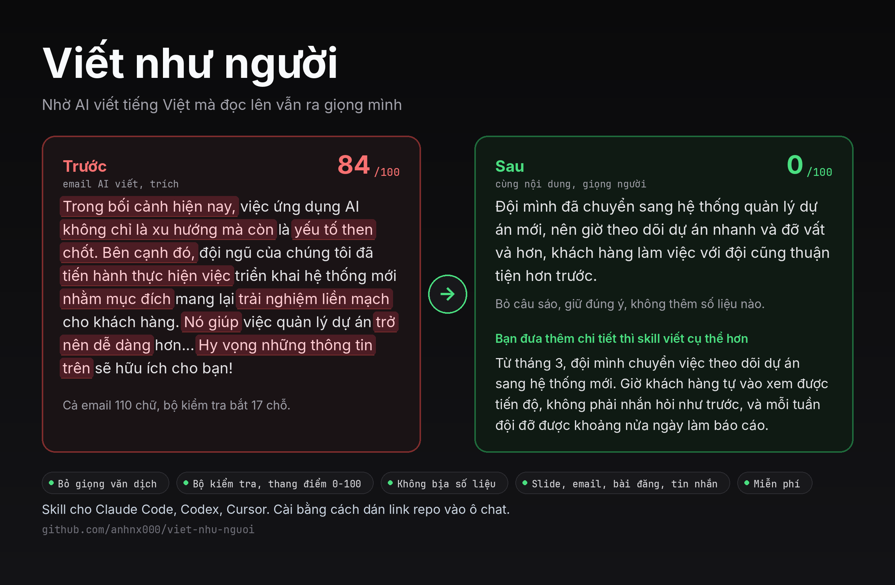
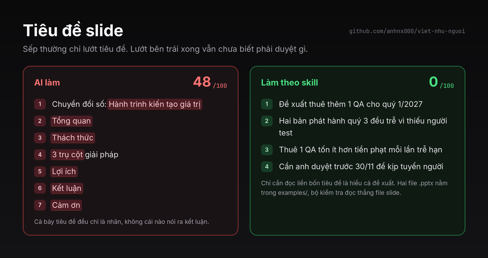
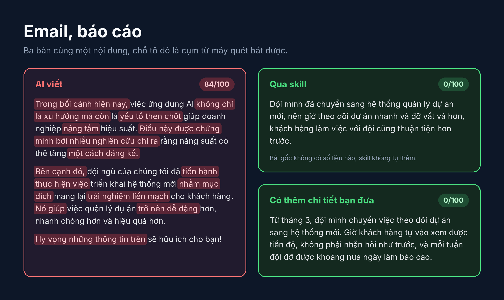
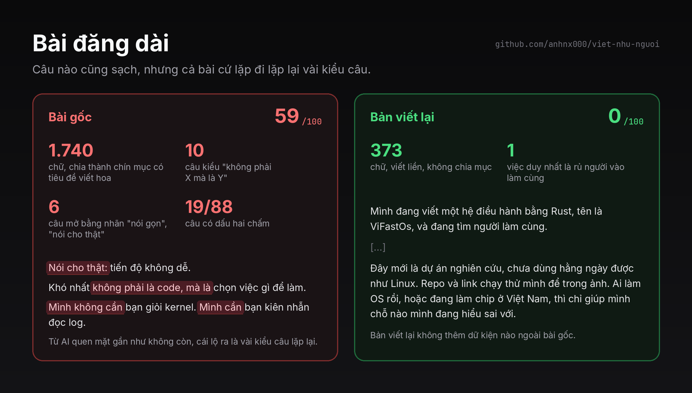
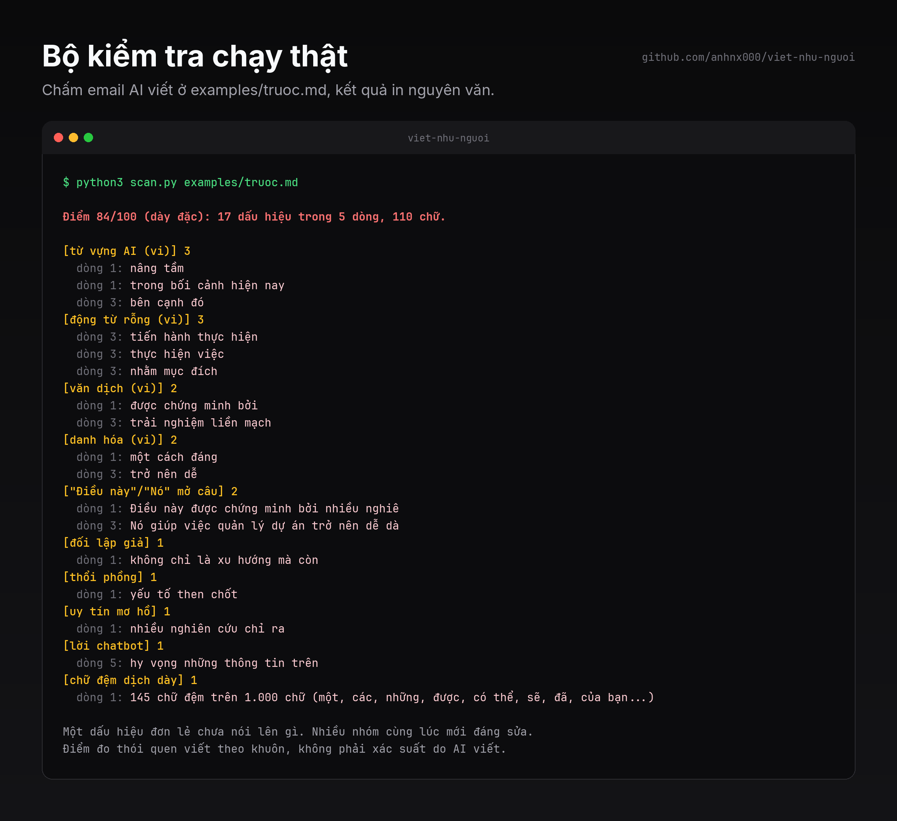

# Viết như người · Vietnamese Humanizer

Skill cho Claude Code, Codex, Cursor: nhờ AI viết tiếng Việt mà đọc lên vẫn ra giọng mình. Bỏ câu sáo, xưng hô đúng vai, số liệu đưa sao để vậy. Bản mới nhất đã chạy 76 đề thử trên cả Claude lẫn Codex, [kết quả ở dưới](#đo-bằng-bộ-đề).

[](https://github.com/anhnx000/viet-nhu-nguoi/actions/workflows/test.yml)
[](LICENSE)

**Tiếng Việt** · [English](README.en.md)



## Cài đặt

Mở Claude Code, Codex, Cursor, Gemini CLI hay OpenCode trên máy tính (bản web của Claude, ChatGPT không cài được), rồi dán câu này vào ô chat.

> Cài giúp tôi skill viet-nhu-nguoi từ https://github.com/anhnx000/viet-nhu-nguoi

Trợ lý xin phép thì bấm đồng ý, chưa tới một phút là xong. Mở cuộc trò chuyện mới rồi thử.

> Viết như người: soạn email xin sếp lùi hạn nộp báo cáo 3 ngày, xưng em

Cập nhật hay gỡ cũng nhờ trợ lý y như vậy. Cài lỗi thì chụp màn hình rồi [mở issue](https://github.com/anhnx000/viet-nhu-nguoi/issues).

<details>
<summary>Cài bằng plugin, git hoặc npx</summary>

Trong Claude Code:

```text
/plugin marketplace add anhnx000/viet-nhu-nguoi
/plugin install viet-nhu-nguoi@viet-nhu-nguoi
```

Hoặc clone về. Script mặc định tạo symlink vào `~/.claude/skills/`, sau này `git pull` là có bản mới:

```bash
git clone https://github.com/anhnx000/viet-nhu-nguoi.git && cd viet-nhu-nguoi
bash install.sh                   # symlink
bash install.sh --copy            # chép file
bash install.sh --copy --update   # thay bản đã chép
```

Ai clone trước ngày 16/11/2026 thì `git pull` sẽ báo lỗi, vì lịch sử repo đã gộp lại. Chạy một lần `git fetch origin && git reset --hard origin/main`, lệnh này bỏ các chỗ đã sửa tay trong thư mục đó.

Cursor, Codex, Gemini CLI, OpenCode thì dùng [skills](https://github.com/vercel-labs/skills): `npx skills add anhnx000/viet-nhu-nguoi -g` (thêm `-a '*' -y` để khỏi bị hỏi).

</details>

<details>
<summary>Hướng dẫn cho trợ lý AI cài hộ</summary>

Người nhờ không rành kỹ thuật, tự làm hết, chỉ xin phép khi chạy lệnh. Thử lần lượt, được thì dừng:

1. Có `npx`: `npx skills add anhnx000/viet-nhu-nguoi -g -y`.
2. Có `git` và `bash`: `git clone https://github.com/anhnx000/viet-nhu-nguoi.git ~/viet-nhu-nguoi && bash ~/viet-nhu-nguoi/install.sh --copy`.
3. Không có: tải `https://github.com/anhnx000/viet-nhu-nguoi/archive/refs/heads/main.zip`, chép `skills/viet-nhu-nguoi` vào thư mục skill của agent (Claude Code: `~/.claude/skills/`, Windows: `%USERPROFILE%\.claude\skills\`).

Xong thì kiểm tra có `SKILL.md` trong thư mục đích, báo đường dẫn, nhắc mở cuộc trò chuyện mới. Cập nhật: cài lại đúng cách cũ (cách 2 thì `git pull` rồi `install.sh --copy --update`). Gỡ: xóa thư mục `viet-nhu-nguoi`.

</details>

## Cách dùng

Cứ nói như nhờ đồng nghiệp. Cùng một đoạn, “sửa để mình gửi” sẽ trả bản dùng ngay, còn “chỉ soi giúp” sẽ chỉ ra câu gượng và dẫn số mục. Skill tự chọn hướng dẫn theo lời nhờ.

| Gõ thế này | Skill làm gì |
| --- | --- |
| "Làm slide báo cáo tiến độ tuần này để sếp duyệt" | Hỏi ai xem, cần họ quyết gì, rồi mới dựng slide. Tiêu đề nào cũng là một câu kết luận |
| "Sửa file bao-cao-q3.pptx cho bớt giọng AI" | Sửa tiêu đề, gạch đầu dòng, ghi chú thuyết trình ngay trong file |
| "Viết email xin sếp lùi deadline 3 ngày, xưng em" | Email ngắn, nói việc trước, giữ "em"/"anh" từ đầu tới cuối |
| "Viết bài Facebook về dự án của mình" | Hỏi một hai chuyện có thật rồi mới viết, không bịa |
| "Rep giúp tin anh Khải trong nhóm này" kèm đoạn chat | Nhắn đúng giọng bạn vẫn dùng với anh Khải, khác giọng bạn đùa với người khác |
| "Soi giúp đoạn này chỗ nào giọng AI" | Chỉ ra từng chỗ kèm lý do, không tự sửa |

Nhờ soạn thứ gì đứng tên bạn thì skill tự bật. Gõ `/viet-nhu-nguoi` để bật cho cả cuộc trò chuyện.

<details>
<summary>Mẹo dùng</summary>

- Nói rõ ai đọc và vai vế: "gửi chị trưởng phòng, xưng em" ra email khác hẳn "gửi khách hàng, xưng chúng tôi".
- Dán kèm một đoạn bạn tự viết cùng loại. Muốn dùng lại ở phiên sau, nhờ lưu giọng vào một file Markdown. Lần sau đưa đường dẫn đó cùng dữ kiện của bài mới.
- Số liệu, tên, ngày tháng đưa bản thật, thiếu thì skill hỏi lại.
- Câu nào không giống mình thì bảo "mình không nói thế", skill nhớ tới hết cuộc trò chuyện.
- Bài bạn tự viết thì skill chỉ sửa nhẹ.
- Tin nhắn, bình luận, bài chê do bạn tự viết thì giữ nguyên chữ viết thường, viết tắt và độ gắt. Skill chỉ bỏ lời chatbot còn sót, như "Chắc chắn rồi! Đây là bài review...".

</details>

## Ví dụ trước và sau

Điểm do bộ kiểm tra đi kèm skill chấm theo thang điểm 0-100, văn càng theo khuôn thì điểm càng cao. Văn bản và file `.pptx` gốc nằm trong [`examples/`](examples).

### Slide



<details>
<summary>Tiêu đề nào cũng là một câu kết luận, sếp lướt bốn tiêu đề là biết phải duyệt gì.</summary>

Bộ AI làm (48/100) có bảy tiêu đề, cái nào cũng chỉ là nhãn: "Chuyển đổi số: Hành trình kiến tạo giá trị", "Tổng quan", "Thách thức", "3 trụ cột giải pháp", "Lợi ích", "Kết luận", "Cảm ơn".

Bộ làm theo skill (0/100) còn bốn tiêu đề, đọc liền là ra cả đề xuất:

1. Đề xuất thuê thêm 1 QA cho quý 1/2027
2. Hai bản phát hành quý 3 đều trễ vì thiếu người test
3. Thuê 1 QA tốn ít hơn tiền phạt mỗi lần trễ hạn
4. Cần anh duyệt trước 30/11 để kịp tuyển người

Skill sửa thẳng trong file `.pptx`, cả tiêu đề, gạch đầu dòng lẫn ghi chú thuyết trình. Hai file ở [`slide-truoc.pptx`](examples/slide-truoc.pptx) và [`slide-sau.pptx`](examples/slide-sau.pptx).

</details>

### Email



<details>
<summary>Bỏ câu sáo mà vẫn giữ đúng ý, từ 84 xuống 0 điểm.</summary>

Bản AI viết ([`truoc.md`](examples/truoc.md)) có 110 chữ mà bộ kiểm tra bắt 17 chỗ, là những chỗ tô đỏ trong ảnh. Mở bài bằng "Trong bối cảnh hiện nay", kết bài bằng "Hy vọng những thông tin trên sẽ hữu ích cho bạn!".

Qua skill ([`sau.md`](examples/sau.md)):

> Đội mình đã chuyển sang hệ thống quản lý dự án mới, nên giờ theo dõi dự án nhanh và đỡ vất vả hơn, khách hàng làm việc với đội cũng thuận tiện hơn trước.

Bản gốc không có số liệu nào nên bản này cũng không có. Bạn đưa thêm chi tiết thì được bản thứ ba ([`sau-co-chi-tiet.md`](examples/sau-co-chi-tiet.md)):

> Từ tháng 3, đội mình chuyển việc theo dõi dự án sang hệ thống mới. Giờ khách hàng tự vào xem được tiến độ, không phải nhắn hỏi như trước, và mỗi tuần đội đỡ được khoảng nửa ngày làm báo cáo.

</details>

### Bài đăng dài



<details>
<summary>Từng câu đều ổn mà đọc vẫn ra giọng AI, vì vài kiểu câu lặp từ đầu tới cuối.</summary>

[Bài gốc](examples/bai-dang-truoc.md) dài 1.740 chữ, gần như không có từ AI quen mặt. Bộ kiểm tra đếm ra mười câu kiểu "không phải X mà là Y", sáu câu mở bằng nhãn như "nói gọn", "nói cho thật", và 19 trên 88 câu có dấu hai chấm, chấm 59/100.

[Bản viết lại](examples/bai-dang-sau.md) còn 373 chữ, chỉ giữ việc rủ người vào làm cùng, không thêm dữ kiện nào. Phần giải thích hệ điều hành là gì và các con số thống kê thì để dành cho bài khác.

</details>

### Kết quả bộ kiểm tra



<details>
<summary>Chỉ ra từng chỗ dính kèm số dòng, chấm được file .md, .txt và .pptx.</summary>

Ảnh trên là kết quả của lệnh này:

```bash
python3 -I skills/viet-nhu-nguoi/scripts/scan.py examples/truoc.md
```

Dấu hiệu xếp theo nhóm, nhóm nào cũng kèm số dòng và cụm bị bắt. Điểm cao nghĩa là văn viết theo khuôn, chưa chắc bài do AI viết. Một dấu hiệu lẻ chưa nói lên gì, nhiều nhóm cùng lúc mới đáng sửa. Tùy chọn của bộ kiểm tra và script so dữ kiện xem ở mục bên dưới.

</details>

## Đo bằng bộ đề

Mỗi bản chạy lại 63 đề thường gặp và 13 đề để riêng (không dùng để chỉnh skill), mỗi đề trong một thư mục tạm chỉ có skill và file đầu vào. Script chấm phần đếm được: cụm phải giữ, số liệu tự thêm, số chữ, số câu hỏi lại, điểm của bộ kiểm tra. Phần còn lại đọc tay. Một bộ 73 lời nhờ khác thử xem skill có tự bật đúng lúc không, kể cả không bật cho câu hỏi về code hay kiến thức.

| Bản 2.13.0, Opus và GPT mức medium | Claude Code | Codex |
| --- | --- | --- |
| 63 đề thường gặp | 60/63 | 59/63 |
| 13 đề để riêng | 10/13 | 10/13 |
| Tự bật khi nên bật | 68/68 lượt | 104/104 lượt |
| Bật nhầm | 0/63 lượt | 2/83 lượt |

Skill viết bằng tiếng Việt. Bản dịch lời dặn sang tiếng Anh đã chạy thử trên Sonnet 5 và Sonnet 5.5, không làm tốt hơn. Đề trượt và câu trả lời của từng đề ghi ở [evals/README.md](evals/README.md), lệnh chạy lại cũng ở đó. Bộ kiểm tra chỉ đếm dấu hiệu bề mặt: với tin tức do AI viết lại, nó vẫn bỏ sót hơn một nửa.

## Dấu hiệu văn AI

Danh mục dấu hiệu vẫn đang thêm dần, cái nào cũng kèm ví dụ trước và sau ([xem đủ](skills/viet-nhu-nguoi/references/patterns.md)). Mấy cái hay gặp trong tiếng Việt:

| Dấu hiệu | Ví dụ | Sửa thành |
| --- | --- | --- |
| Bị động kiểu dịch | được phát triển bởi Google | Google phát triển |
| Danh hóa | Việc áp dụng AI giúp việc quản lý trở nên dễ dàng | Dùng AI thì quản lý dễ hơn |
| Động từ rỗng | tiến hành thực hiện việc rà soát | rà soát |
| Cụm marketing dịch sát | mở khóa tiềm năng, trải nghiệm liền mạch | nói cụ thể làm được gì |
| Xưng hô | cả bài "bạn" gửi sếp | một cặp xưng hô đúng vai |
| Chêm tiếng Anh | hiệu suất (performance) | hiệu suất |

Skill để yên giọng vùng miền, khẩu ngữ, từ Hán Việt dùng đúng chỗ, bị động trong tài liệu kỹ thuật, và mấy chữ bỏ đi là đổi nghĩa như "vẫn", "chưa", "chỉ", "có thể".

<details>
<summary>Văn dịch và kiểu câu lặp khắp bài</summary>

Khó thấy hơn là văn dịch từng chữ. Chữ nào cũng tiếng Việt mà câu vẫn theo khuôn tiếng Anh, mở bằng "Với...", "Để..., bạn cần...", rải "của bạn", "một", "các", "sẽ" khắp bài. Gặp kiểu này skill viết lại từ ý.

Có tật phải đọc cả bài mới thấy. Từng câu ổn, nhưng "không phải X mà là Y" lặp năm lần, đoạn nào cũng kết bằng một câu nghe như châm ngôn, hai chấm dày đặc, chia mục bằng emoji, cuối bài mời bình luận.

</details>

<details>
<summary>Slide và tin nhắn</summary>

Slide thì hay có tiêu đề chỉ là nhãn hoặc đếm số ("3 trụ cột"), slide nào cũng đúng ba ý, ghi chú thuyết trình như công văn ([slides.md](skills/viet-nhu-nguoi/references/slides.md)).

Tin nhắn thì icon, kiểu cười, viết tắt học từ 30 lượt chat gần nhất, giọng đổi theo người nhận, "à", "nhé", "ạ" giữ đúng ý hỏi, nhờ hay hứa ([chat.md](skills/viet-nhu-nguoi/references/chat.md), [spoken.md](skills/viet-nhu-nguoi/references/spoken.md)).

</details>

<details>
<summary>Tra dấu hiệu, quét file và so dữ kiện</summary>

Từ thư mục repo, chạy `python3 -I skills/viet-nhu-nguoi/scripts/patterns.py 46` để lấy ví dụ ở mục 46. Thay số bằng chữ `H` để tra nhóm slide, bỏ đối số để xem các tiêu đề. Các script chỉ dùng thư viện chuẩn của Python. `scan.py` chấm file `.md`, `.txt`, `.pptx`:

```bash
python3 -I skills/viet-nhu-nguoi/scripts/scan.py file.md
```

| Tùy chọn | Tác dụng |
| --- | --- |
| `--max 30` | điểm quá 30 thì thoát mã 1, dùng cho CI, pre-commit |
| `--meta` | bỏ qua phần trích dẫn, cho văn bản bàn về chính các dấu hiệu |
| `--chat` | chấm tin nhắn: báo thêm gạch đầu dòng, in đậm, câu khách sáo |
| `--titles`, `--text` | in tiêu đề, hoặc toàn bộ chữ và ghi chú của file `.pptx` |
| `--json` | in cho máy đọc |

Bài xưng "mình", "tôi" thì bộ kiểm tra liệt kê thêm các chi tiết riêng có con số để bạn hỏi lại người đứng tên, vì AI viết hộ hay bịa đúng loại này. Dòng đó không tính điểm.

`check_facts.py` so bản gốc với bản sửa, báo số liệu, ngày giờ, link, code bị mất hoặc tự thêm. Có `--brief loi-dan.txt` thì so bài AI viết với lời dặn bạn đưa, liệt kê thứ bạn chưa hề nói:

```bash
python3 -I skills/viet-nhu-nguoi/scripts/check_facts.py goc.md moi.md
python3 -I skills/viet-nhu-nguoi/scripts/check_facts.py --brief loi-dan.txt bai.md
```

</details>

<details>
<summary>Quyền riêng tư và giới hạn</summary>

Văn bản chỉ đi tới mô hình AI mà trợ lý vốn đang dùng. Script không kết nối mạng, không thu thập gì. Điểm cao nghĩa là viết theo khuôn nhiều, không có nghĩa là AI viết, vì có người vốn viết câu đều nhịp.

Skill không hứa qua được phần mềm kiểm tra AI, không chơi mẹo như cố ý sai chính tả hay chèn ký tự ẩn. Đừng dùng để làm bài hộ, giả danh người khác, hay cầm danh sách dấu hiệu đi kết luận ai đó dùng AI.

</details>

<details>
<summary>Báo lỗi và đóng góp</summary>

Gặp câu AI tiếng Việt skill chưa bắt, hay skill sửa hỏng một câu vốn tự nhiên, thì [mở issue](https://github.com/anhnx000/viet-nhu-nguoi/issues) kèm câu đó và bản bạn thấy đúng. Pull request thêm dấu hiệu cần ví dụ trước/sau và test trong `tests/test_scan.py`, có cả câu không được báo nhầm.

</details>

<details>
<summary>Cấu trúc thư mục</summary>

```text
skills/viet-nhu-nguoi/
├── SKILL.md                 quy tắc chung và bảng chọn theo lời nhờ
├── references/
│   ├── draft.md, edit*.md, review.md       viết mới, sửa, soi lỗi
│   ├── patterns.md                        tra dấu hiệu theo số mục
│   ├── voice.md, spoken.md                mẫu giọng, lời thoại và lời họp
│   ├── vietnamese.md, long-form.md        văn dịch, bài dài
│   ├── chat*.md                           nhắn tin, đổi người nhận, giọng miền
│   ├── slides*.md                         soạn slide, soát file, đọc thử
│   └── sources.md                         nguồn và bảng đối chiếu 20 repo
├── scripts/patterns.py      tra ví dụ theo số mục hoặc nhóm
├── scripts/scan.py          bộ kiểm tra, thang điểm 0-100
├── scripts/check_facts.py   so dữ kiện giữa hai bản
└── scripts/slides.py        đọc chữ và ghi chú trong .pptx
assets/                      ảnh README, script vẽ lại (make_images.py)
examples/                    văn mẫu và deck .pptx trước/sau
evals/                       bộ đề thử hành vi của skill
tests/                       python3 -m unittest discover -s tests
```

</details>

<details>
<summary>Nguồn tham khảo</summary>

- Wikipedia: [Signs of AI writing](https://en.wikipedia.org/wiki/Wikipedia:Signs_of_AI_writing).
- [blader/humanizer](https://github.com/blader/humanizer), MIT, Copyright (c) 2025 Siqi Chen. Khung danh mục dấu hiệu dựa theo skill này.
- Các skill humanize tiếng Việt (MIT) dùng để đối chiếu, nội dung ở đây viết lại: [longhang2004/vietnamese-humanizer](https://github.com/longhang2004/vietnamese-humanizer), [andyluu98/vn-humanize](https://github.com/andyluu98/vn-humanize), [cuongducle/viet-humanize](https://github.com/cuongducle/viet-humanize), [pdh372/humanize-vietnamese](https://github.com/pdh372/humanize-vietnamese).
- Phần slide học ý từ [carnot-tech/jinba-consulting-pptx-skill](https://github.com/carnot-tech/jinba-consulting-pptx-skill) (MIT), [zarazhangrui/frontend-slides](https://github.com/zarazhangrui/frontend-slides) (MIT) và `doc-coauthoring` trong [anthropics/skills](https://github.com/anthropics/skills) (Apache 2.0).
- Đủ nguồn ở [sources.md](skills/viet-nhu-nguoi/references/sources.md).

</details>
