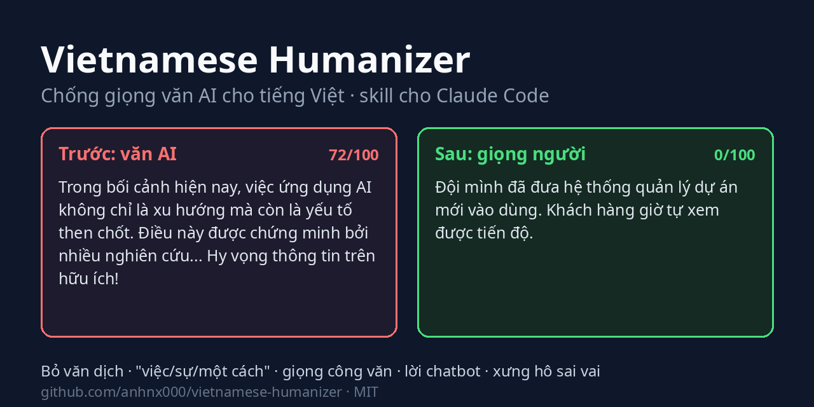
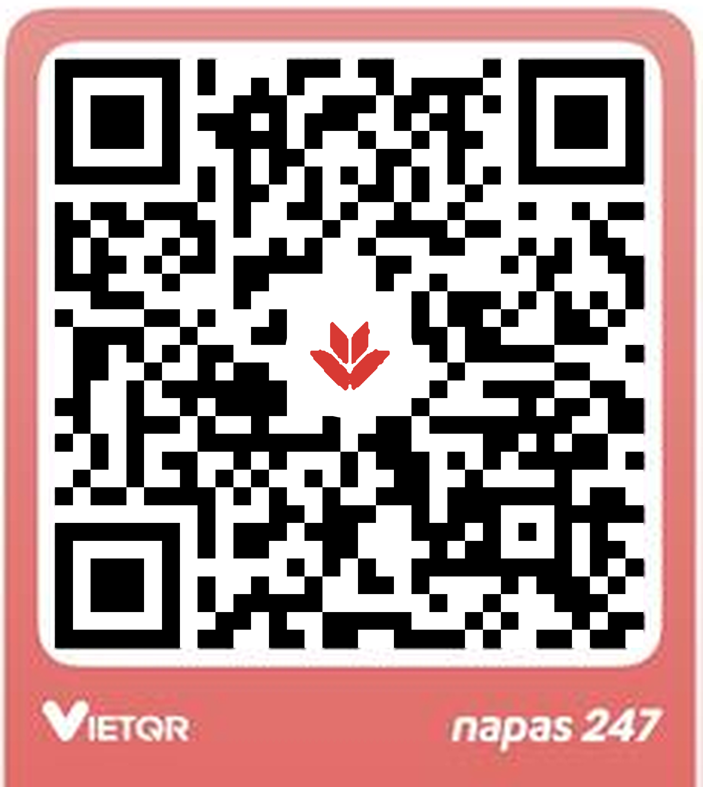

# Viết như người · Vietnamese Humanizer

**Chống giọng văn AI cho tiếng Việt. Nhờ AI viết, đọc lên vẫn là bạn.**

[](https://github.com/anhnx000/viet-nhu-nguoi/actions/workflows/test.yml)
[](LICENSE)

**Tiếng Việt** · [English](README.en.md)



> **English:** a Claude skill that makes AI-drafted Vietnamese (and English) read like a person wrote it, without changing the facts. Read the [English README](README.en.md).
>
> *Viet nhu nguoi, chong giong van AI, human voice, Vietnamese humanizer, humanize tieng Viet, viet lai van AI tu nhien, bo giong ChatGPT.*

Nhờ AI làm slide, viết email, viết báo cáo thì nhanh, nhưng người đọc nhận ra ngay. Tiêu đề slide là "Tổng quan", "Thách thức". Email mở bằng "Trong bối cảnh hiện nay", kết bằng "Hy vọng thông tin trên hữu ích!". Câu nào cũng "tiến hành thực hiện việc...". Gửi trong nhóm thì không sao, gửi lãnh đạo hay khách hàng thì lại mất công ngồi sửa.

Viết như người là một skill (kỹ năng cài thêm) cho Claude và các trợ lý AI khác. Cài xong, AI viết tiếng Việt như người đi làm thật: tiêu đề slide nói thẳng kết luận, email xưng hô đúng vai, câu gọn, số liệu giữ nguyên. Miễn phí, mã nguồn mở.

*Viet nhu nguoi, chong giong van AI, human voice, Vietnamese humanizer, humanize tieng Viet, bo giong ChatGPT.*

**Đi nhanh:** [Cài, không cần biết code](#cài-trong-vài-phút-không-cần-biết-code) · [Dùng hằng ngày](#dùng-hằng-ngày) · [Trước và sau](#trước-và-sau) · [Skill bắt những gì](#skill-bắt-những-gì) · [Dòng lệnh](#cho-người-dùng-dòng-lệnh) · [Mời một ly cà phê](#mời-một-ly-cà-phê)

## Dùng vào việc gì

- Slide báo cáo, đề xuất: mỗi tiêu đề là một câu kết luận, đọc lướt tiêu đề là biết cần lãnh đạo quyết gì. Thiếu số liệu thì ghi `[cần xác nhận]`, không bịa cho đầy.
- Email cho sếp, khách hàng: xưng hô đúng vai (anh/chị/em, quý khách), không mặc định "bạn", nói việc trước.
- Báo cáo, tài liệu dịch từ tiếng Anh: bỏ kiểu câu dịch "được... bởi", "Điều này cho phép", "thông qua việc".
- Bài Facebook, LinkedIn, blog: AI viết nháp nhưng giữ giọng của bạn, kể một chuyện cho gọn thay vì ôm hết mọi thứ.
- Soi trước khi gửi: chỉ ra chỗ nào nghe giống AI, bạn tự quyết sửa hay không.

## Cài trong vài phút, không cần biết code

Bạn không phải gõ lệnh nào. Bạn nhờ trợ lý AI tự cài, giống nhờ một bạn IT ngồi cạnh.

**Bước 1. Mở một trợ lý AI chạy trên máy tính.** Ví dụ ứng dụng Claude Code trên máy tính (có giao diện bấm chuột, không cần cửa sổ dòng lệnh), hoặc Codex, Cursor, Gemini CLI, OpenCode. Bản chat trên web của Claude hay ChatGPT không cài được gì vào máy, nên cần một trong các bản này.

**Bước 2. Dán câu này vào ô chat:**

> Cài giúp tôi skill viet-nhu-nguoi từ https://github.com/anhnx000/viet-nhu-nguoi

**Bước 3. Bấm đồng ý** khi trợ lý xin phép tải và cài. Thường mất chưa tới một phút.

**Bước 4. Mở một cuộc trò chuyện mới và thử:**

> Viết như người: soạn giúp tôi email xin sếp lùi hạn nộp báo cáo 3 ngày, xưng em

Email trả về ngắn, nói việc trước, xưng "em" từ đầu đến cuối là skill đã chạy.

Vài câu hay cần về sau, cũng chỉ việc nói với trợ lý:

| Bạn muốn | Bạn gõ |
| --- | --- |
| Kiểm tra đã cài chưa | "Máy tôi có skill viet-nhu-nguoi chưa?" |
| Lấy bản mới | "Cập nhật skill viet-nhu-nguoi lên bản mới nhất" |
| Gỡ ra | "Gỡ skill viet-nhu-nguoi khỏi máy" |

Trợ lý báo lỗi khi cài? Chụp màn hình rồi [mở issue](https://github.com/anhnx000/viet-nhu-nguoi/issues), mình xem giúp.

<details>
<summary>Dành cho trợ lý AI được nhờ cài skill này</summary>

Người dùng không rành kỹ thuật, nên hãy tự làm hết và chỉ xin phép khi cần chạy lệnh. Thử lần lượt, dừng ở cách đầu tiên chạy được:

1. Có `npx`: chạy `npx skills add anhnx000/viet-nhu-nguoi -g -y`.
2. Có `git` và `bash` (macOS, Linux, WSL): `git clone https://github.com/anhnx000/viet-nhu-nguoi.git ~/viet-nhu-nguoi && bash ~/viet-nhu-nguoi/install.sh --copy`.
3. Windows không có bash, hoặc không có git: tải `https://github.com/anhnx000/viet-nhu-nguoi/archive/refs/heads/main.zip`, giải nén, rồi chép thư mục `skills/viet-nhu-nguoi` vào thư mục skill cấp người dùng của agent (Claude Code: `~/.claude/skills/viet-nhu-nguoi`, trên Windows là `%USERPROFILE%\.claude\skills\viet-nhu-nguoi`).

Cài xong, kiểm tra file `SKILL.md` nằm đúng trong thư mục đích, báo cho người dùng đường dẫn đã cài, và nhắc họ mở cuộc trò chuyện mới nếu skill chưa hiện. Cập nhật thì lặp lại đúng cách đã dùng; với cách 2 và 3, xóa thư mục cũ trước. Gỡ thì xóa thư mục `viet-nhu-nguoi` trong thư mục skill.

</details>

<details>
<summary>Dành cho người quen dòng lệnh: tự gõ lệnh cài</summary>

Trong Claude Code, cài như plugin:

```text
/plugin marketplace add anhnx000/viet-nhu-nguoi
/plugin install viet-nhu-nguoi@viet-nhu-nguoi
```

Hoặc clone rồi chạy script. Script tạo symlink vào `~/.claude/skills/`, sau này `git pull` là skill được cập nhật:

```bash
git clone https://github.com/anhnx000/viet-nhu-nguoi.git
cd viet-nhu-nguoi
bash install.sh          # symlink
bash install.sh --copy   # hoặc chép file, nếu muốn đọc lại từng bản cập nhật trước khi cài
```

Agent khác (Cursor, Codex, Gemini CLI, OpenCode...) cài bằng công cụ [skills](https://github.com/vercel-labs/skills):

```bash
npx skills add anhnx000/viet-nhu-nguoi      # chỉ cho dự án hiện tại
npx skills add anhnx000/viet-nhu-nguoi -g   # cho mọi dự án (cấp người dùng)
```

Lệnh sẽ hỏi cài cho agent nào; thêm `-a claude-code` (hoặc `-a '*'`) và `-y` để bỏ qua các câu hỏi. Skill chỉ là Markdown nên chạy được với mô hình nào mà editor của bạn đang dùng.

</details>

## Dùng hằng ngày

Cứ nói như nhờ đồng nghiệp. Không có cú pháp nào phải nhớ.

| Bạn gõ | Skill làm gì |
| --- | --- |
| "Làm slide báo cáo tiến độ dự án tuần này để sếp duyệt" | Hỏi trước: ai xem, cần họ quyết gì, trình bày trực tiếp hay gửi đọc. Rồi mới dựng slide |
| "Sửa file bao-cao-q3.pptx cho bớt giọng AI" | Đọc chữ và ghi chú từng slide, sửa tiêu đề, gạch đầu dòng, lời thuyết trình |
| "Viết email xin sếp lùi deadline 3 ngày, xưng em" | Viết email ngắn, nói việc trước, giữ đúng "em"/"anh" từ đầu đến cuối |
| "Viết bài Facebook kể về dự án của mình, khoảng 300 chữ" | Hỏi bạn một hai chuyện thật đã xảy ra, rồi kể đúng một chuyện. Không chia mục, không giảng lại kiến thức nền |
| "Soi giúp đoạn này chỗ nào giọng AI" | Chỉ ra từng chỗ kèm lý do và gợi ý sửa, không tự sửa |
| Dán kèm một email bạn tự viết | Học nhịp câu, từ nối, cách xưng hô của bạn rồi viết theo |

Bốn thói quen giúp kết quả tốt hơn hẳn:

1. Nói rõ ai đọc và bạn là ai với họ. "Gửi chị trưởng phòng, xưng em" cho ra email khác hẳn "gửi khách hàng, xưng chúng tôi".
2. Dán một đoạn bạn tự viết, cùng loại với bài sắp viết. Skill bắt chước độ dài câu và từ bạn hay dùng.
3. Đưa số liệu, tên, ngày thật. Thiếu thì skill hỏi lại hoặc để trống, nó không tự nghĩ ra.
4. Thấy chỗ nào lạ thì nói "mình không nói thế". Skill đổi theo và nhớ cho phần còn lại của cuộc trò chuyện.

Vài cách gọi khác:

- Gõ `/viet-nhu-nguoi` để bật cho cả phiên. Từ đó mọi câu trả lời đều theo quy tắc của skill, kể cả tin nhắn ngắn.
- Skill cũng tự bật khi bạn nhờ soạn email, tin nhắn, bài đăng mà bạn sẽ gửi dưới tên mình.
- Gọi giọng bằng tên: *đời thường*, *công việc*, *kỹ thuật*, *ấm áp*, *thẳng*. Tên giọng chỉ đổi văn phong, xưng hô và nội dung giữ nguyên.
- Bài bạn tự viết thì skill chỉ sửa nhẹ.

## Trước và sau

### Slide

Hai bộ slide mẫu trong [`examples/`](examples), chỉ đọc tiêu đề.

Slide AI làm:

```text
1. Chuyển đổi số: Hành trình kiến tạo giá trị
2. Tổng quan
3. Thách thức
4. 3 trụ cột giải pháp
5. Lợi ích
6. Kết luận
7. Cảm ơn
```

Slide làm theo skill:

```text
1. Đề xuất thuê thêm 1 QA cho quý 1/2027
2. Quý 3 trễ 2 tuần, cả 2 lần đều do thiếu người test
3. Thuê 1 QA rẻ hơn tiếp tục trễ
4. Cần anh duyệt trước 30/11 để kịp tuyển
```

Bộ thứ hai chỉ cần đọc bốn tiêu đề là hiểu cả đề xuất. Máy quét đi kèm chấm bộ đầu 48/100, bộ sau 0/100.

### Email, báo cáo

Bản AI viết:

> Trong bối cảnh hiện nay, việc ứng dụng AI không chỉ là xu hướng mà còn là yếu tố then chốt giúp doanh nghiệp nâng tầm hiệu suất. Điều này được chứng minh bởi nhiều nghiên cứu chỉ ra rằng năng suất có thể tăng một cách đáng kể.
>
> Bên cạnh đó, đội ngũ của chúng tôi đã tiến hành thực hiện việc triển khai hệ thống mới nhằm mục đích mang lại trải nghiệm liền mạch cho khách hàng. Nó giúp việc quản lý dự án trở nên dễ dàng hơn, nhanh chóng hơn và hiệu quả hơn.
>
> Hy vọng những thông tin trên sẽ hữu ích cho bạn!

Sau khi qua skill:

> Đội mình đã đưa hệ thống quản lý dự án mới vào dùng. Khách hàng giờ tự xem được tiến độ.

Skill không bịa số liệu. Muốn bài có chi tiết thì nó hỏi bạn, rồi viết đúng với những gì bạn đưa:

> Từ tháng 3, đội mình chuyển việc theo dõi dự án sang hệ thống mới. Khách hàng tự xem tiến độ, không phải nhắn hỏi như trước, và mỗi tuần đội bớt được khoảng nửa ngày làm báo cáo.

Máy quét chấm bản đầu 72/100 với 16 dấu hiệu, hai bản sau đều 0/100.

### Bài đăng dài

Ví dụ này là lý do có bản 2.2. [Bài gốc](examples/bai-dang-truoc.md) dài 1.740 chữ, chín mục viết hoa, đã sạch gần hết từ ngữ AI quen thuộc nên máy quét bản cũ chấm 3/100. Người đọc vẫn nhận ra ngay, vì nó lặp cùng vài động tác suốt bài:

> Nói cho thật: tiến độ không dễ. [...] Khó nhất không phải là code, mà là chọn việc gì để làm. [...] Mình không cần bạn giỏi kernel. Mình cần bạn kiên nhẫn đọc log.

Bản 2.2 đếm trên cả bài và chấm 55/100: mười câu "không phải X mà là Y", sáu nhãn kiểu "nói gọn", "nói cho thật", 20 trên 88 câu có dấu hai chấm. [Bản viết lại](examples/bai-dang-sau.md) còn 376 chữ, kể đúng một việc là rủ người vào làm cùng, và được 0/100. Nó không thêm dữ kiện nào ngoài bài gốc. Phần định nghĩa hệ điều hành, lịch sử microkernel và thống kê bảo mật được để dành cho bài khác.

## Skill bắt những gì

Danh mục đầy đủ có 53 dấu hiệu, mỗi dấu hiệu kèm ví dụ trước/sau, nằm trong [references/patterns.md](skills/viet-nhu-nguoi/references/patterns.md). Nhóm G dành riêng cho tiếng Việt:

| Dấu hiệu | Ví dụ | Sửa thành |
| --- | --- | --- |
| Bị động kiểu dịch | được phát triển bởi Google | Google phát triển |
| "Điều này", "Nó" mở câu | Điều này cho phép người dùng... | gọi tên sự vật, hoặc lược chủ ngữ |
| Danh hóa | Việc áp dụng AI giúp việc quản lý trở nên dễ dàng | Dùng AI thì quản lý dễ hơn |
| Động từ rỗng | tiến hành thực hiện việc rà soát | rà soát |
| Cụm marketing dịch sát | mở khóa tiềm năng, trải nghiệm liền mạch | nói cụ thể làm được gì |
| Chuỗi "của" | sự nâng cao của năng suất của nhân viên | nhân viên làm được nhiều hơn |
| Thừa nghĩa | hiện nay đang trong quá trình | đang |
| Xưng hô | cả bài "bạn" gửi sếp, trộn "bạn"/"quý vị" | một cặp xưng hô đúng vai |
| Chêm tiếng Anh | hiệu suất (performance) | hiệu suất |

Nhóm I là những dấu hiệu chỉ thấy khi nhìn cả bài, sau khi từng câu đã sạch: nhãn báo giọng ("nói gọn", "nói cho thật:"), "không phải X mà là Y" lặp từ ba lần, đoạn nào cũng chốt một câu châm ngôn, dấu hai chấm dồn dập, bài đăng dài ôm đủ mọi chủ đề.

Nhóm H dành cho slide và tài liệu nhiều trang: tiêu đề dạng nhãn ("Tổng quan", "Kết luận"), tiêu đề đếm số ý ("3 trụ cột"), slide nào cũng đúng ba ý, hứa suông ("chi tiết sẽ trao đổi sau"), ghi chú thuyết trình viết như công văn. Hướng dẫn riêng cho slide nằm trong [references/slides.md](skills/viet-nhu-nguoi/references/slides.md). Các nhóm còn lại áp cho cả tiếng Việt lẫn tiếng Anh: đối lập giả, câu chốt một dòng, bộ ba ép buộc, gạch ngang dài, thổi phồng, mượn uy tín mơ hồ, in đậm và emoji trang trí, lời chatbot, giải thích lại điều người đọc đã biết.

Skill cũng biết khi nào không nên sửa: giọng vùng miền, khẩu ngữ, thuật ngữ Hán Việt đúng chỗ, câu bị động trong tài liệu kỹ thuật, và các từ nhỏ làm đổi nghĩa như "vẫn", "chưa", "chỉ", "có thể" đều được giữ.

## Cho người dùng dòng lệnh

Hai script đi kèm chỉ dùng thư viện chuẩn của Python.

- Quét điểm: `python3 -I skills/viet-nhu-nguoi/scripts/scan.py file.md` (hoặc `file.pptx`) in điểm 0-100 và từng chỗ khớp. Thêm `--json` để lấy kết quả dạng máy đọc, `--max 30` để thoát mã 1 khi điểm vượt ngưỡng (dùng cho CI hay pre-commit), `--titles` để chỉ in các tiêu đề theo thứ tự, `--text` để in toàn bộ chữ và ghi chú của từng slide trong file `.pptx`.
- Kiểm dữ kiện: `python3 -I skills/viet-nhu-nguoi/scripts/check_facts.py goc.md moi.md` (đọc được cả `.pptx`) báo lỗi khi số liệu, ngày giờ, link hay code bị mất hoặc bị thêm, và nhắc khi thiếu tên riêng.
- Deck quan trọng: nhờ một agent mới, không biết bối cảnh, đọc thử, chấm 7 tiêu chí (thang 70 điểm), rồi lập bảng góp ý nhận/không nhận cho bạn quyết.

```text
$ python3 -I skills/viet-nhu-nguoi/scripts/scan.py examples/truoc.md
Điểm 72/100 (dày đặc): 16 dấu hiệu trong 5 dòng, 110 chữ.
[từ vựng AI (vi)] 3      nâng tầm, trong bối cảnh hiện nay, bên cạnh đó
[động từ rỗng (vi)] 3    tiến hành thực hiện, thực hiện việc, nhằm mục đích
[văn dịch (vi)] 2        được chứng minh bởi, trải nghiệm liền mạch
[danh hóa (vi)] 2        một cách đáng..., trở nên dễ...
["Điều này"/"Nó" mở câu] 2
[đối lập giả] 1          không chỉ là xu hướng mà còn
[thổi phồng] 1           yếu tố then chốt
[uy tín mơ hồ] 1         nhiều nghiên cứu chỉ ra
[lời chatbot] 1          hy vọng những thông tin trên

$ python3 -I skills/viet-nhu-nguoi/scripts/scan.py examples/slide-truoc.pptx
Điểm 48/100 (nhiều dấu hiệu): 21 dấu hiệu trong 7 slide, 176 chữ.
[từ vựng AI (vi)] 7
[tiêu đề dạng nhãn] 4        slide 2: Tổng quan, slide 3: Thách thức, slide 5: Lợi ích, slide 6: Kết luận
[hứa suông] 1                slide 5, ghi chú: chi tiết sẽ được trao đổi sau
[tiêu đề đếm số ý] 1         slide 4: 3 trụ cột giải pháp
[câu khó nói (ghi chú)] 1    slide 2, ghi chú: Như chúng ta có thể thấy, ...
[số gạch đầu dòng đều] 1     5/5 slide có đúng 3 ý
...
```

## Nên biết

Skill không gửi gì ra ngoài, ngoài những gì agent của bạn vốn gửi cho mô hình. Skill gồm Markdown và hai script Python không cần thư viện ngoài, không gọi mạng, không thu thập dữ liệu, không cần tài khoản.

Điểm số chỉ để tham khảo, không phải phán quyết: điểm đo văn bản có bao nhiêu thói quen viết theo khuôn và câu có đều nhau không, không phải xác suất văn bản do AI viết. Có người vốn viết câu đều nhịp, và máy dò AI hay báo nhầm với người viết không phải tiếng mẹ đẻ. Điểm cao thì coi đó là danh sách chỗ cần đọc lại.

Skill giúp văn bản tự nhiên và dễ đọc hơn, nhưng không cam kết qua được máy dò AI, và không dùng mẹo lừa máy dò như lỗi chính tả cố ý hay ký tự ẩn. Đừng dùng nó để nộp bài thay người học hay giả danh người khác. Cũng đừng dùng danh sách dấu hiệu để kết luận ai đó dùng AI: người đoán bằng cảm giác cũng chỉ đúng hơn may rủi một chút.

## Cấu trúc

```text
skills/viet-nhu-nguoi/
├── SKILL.md                 quy tắc chính, Claude nạp khi skill được gọi
├── references/patterns.md   53 dấu hiệu, ví dụ trước/sau
├── references/slides.md     cách viết slide, lời thuyết trình, nhờ người đọc thử
├── references/sources.md    nguồn tham khảo: bài viết, nghiên cứu, hướng dẫn giọng văn, skill khác
├── scripts/scan.py          máy quét có điểm 0-100, không cần thư viện ngoài
├── scripts/check_facts.py   kiểm bản sửa giữ đúng số liệu, ngày giờ, link, code
├── scripts/slides.py        đọc chữ và ghi chú trong file .pptx, chỉ dùng thư viện chuẩn
└── LICENSE-humanizer        giấy phép MIT của blader/humanizer
assets/                      banner và mã QR mời cà phê
examples/                    văn mẫu và deck .pptx trước/sau dùng trong README và test
tests/test_scan.py           python3 -m unittest discover -s tests
```

## Đóng góp

Gặp một kiểu câu AI tiếng Việt mà skill chưa bắt, hoặc thấy skill sửa sai một câu vốn tự nhiên? Mở issue và dán câu đó vào, kèm bản bạn thấy đúng. Pull request thêm dấu hiệu mới nên có ví dụ trước/sau và một test trong `tests/test_scan.py`, gồm cả trường hợp không được báo nhầm.

<a id="support"></a>

## Mời một ly cà phê

Viết như người miễn phí, giấy phép MIT, và sẽ giữ như vậy. Mình làm skill này vào thời gian rảnh. Nếu nó giúp bạn bớt một buổi ngồi sửa văn, bạn có thể mời mình một ly cà phê sữa đá.

<table>
  <tr>
    <td width="250" align="center">
      
    </td>
    <td>
      <b>Quét bằng app ngân hàng nào cũng được</b> (VietQR / Napas 247).<br><br>
      Số tiền tùy bạn, một ly cà phê là mình vui cả buổi.<br><br>
      Nội dung chuyển khoản ghi <code>viet-nhu-nguoi</code> để mình biết ly này từ đâu tới.
    </td>
  </tr>
</table>

Tiền cà phê đổi thành thời gian cho ba việc:

- cập nhật danh mục khi mô hình mới ra, vì mỗi đời mô hình lại có bộ từ ưa dùng riêng;
- biến những câu các bạn báo thành test, đọc và trả lời issue, pull request;
- làm tốt thêm máy quét và công cụ kiểm dữ kiện.

Chưa tiện chuyển khoản thì ba việc này quý không kém: gắn sao cho repo, giới thiệu cho một người hay dùng AI viết tiếng Việt, hoặc mở issue kèm một câu skill sửa chưa đúng. Có mời cà phê hay không thì issue của ai cũng được xem như nhau.

## Nguồn

- Wikipedia: [Signs of AI writing](https://en.wikipedia.org/wiki/Wikipedia:Signs_of_AI_writing) (WikiProject AI Cleanup).
- [blader/humanizer](https://github.com/blader/humanizer), MIT, Copyright (c) 2025 Siqi Chen. Khung danh mục dấu hiệu dựa trên skill này.
- Các skill humanize tiếng Việt mã nguồn mở (MIT), dùng để đối chiếu danh mục; nội dung ở đây viết lại theo cách riêng: [longhang2004/vietnamese-humanizer](https://github.com/longhang2004/vietnamese-humanizer), [andyluu98/vn-humanize](https://github.com/andyluu98/vn-humanize), [cuongducle/viet-humanize](https://github.com/cuongducle/viet-humanize), [pdh372/humanize-vietnamese](https://github.com/pdh372/humanize-vietnamese).
- Phần slide học ý tưởng (viết lại bằng lời riêng) từ [carnot-tech/jinba-consulting-pptx-skill](https://github.com/carnot-tech/jinba-consulting-pptx-skill) (MIT), [zarazhangrui/frontend-slides](https://github.com/zarazhangrui/frontend-slides) (MIT) và skill `doc-coauthoring` trong [anthropics/skills](https://github.com/anthropics/skills) (Apache 2.0).
- Danh sách nguồn đầy đủ gồm bài viết, sách và nghiên cứu về tiếng Việt, nghiên cứu về độ tin cậy của máy dò, hướng dẫn giọng văn và các skill khác. Danh sách ghi rõ nguồn nào skill dựa vào trực tiếp: [references/sources.md](skills/viet-nhu-nguoi/references/sources.md).
