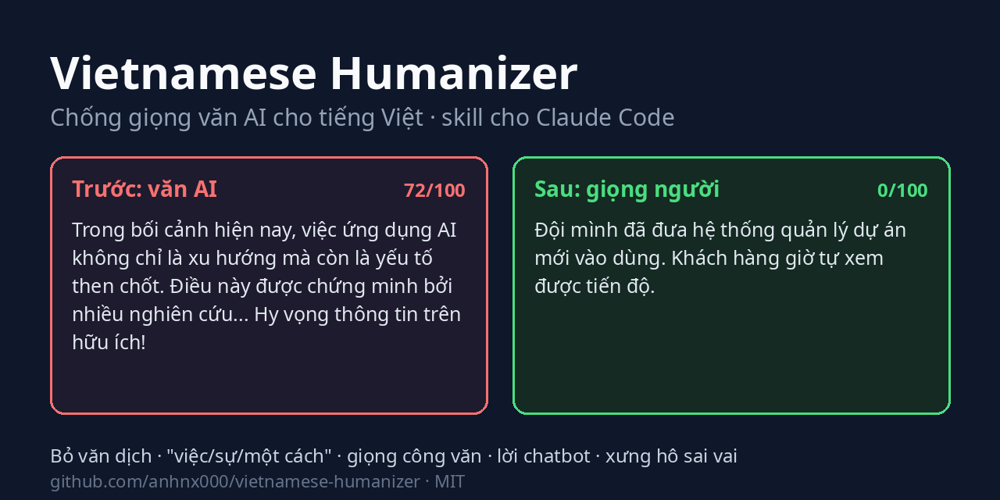
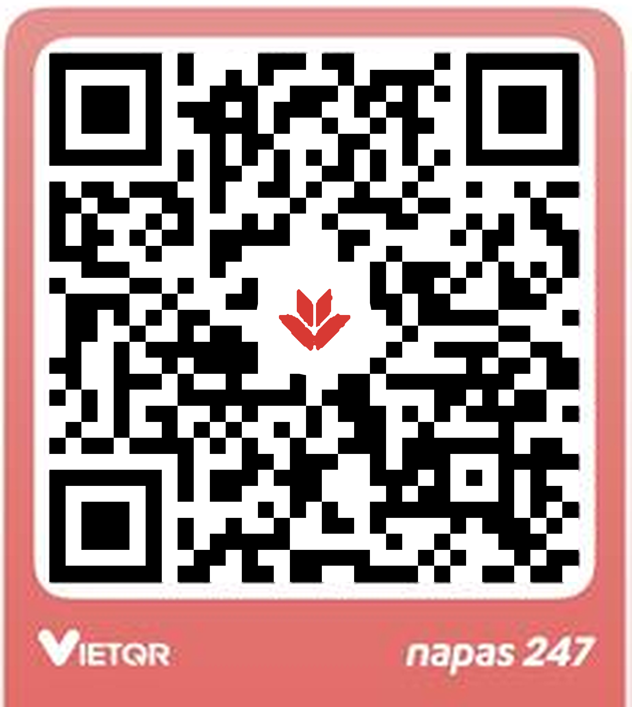

# Viết như người · Vietnamese Humanizer

**Chống giọng văn AI cho tiếng Việt (human voice).**

[](https://github.com/anhnx000/viet-nhu-nguoi/actions/workflows/test.yml)
[](LICENSE)

[English](README.md) · **Tiếng Việt**



Skill cho [Claude Code](https://code.claude.com/docs/en/skills) giúp văn tiếng Việt do AI viết đọc lên giống người viết. Nó bỏ những thứ khiến người đọc nhận ra ngay là "con AI viết": "Trong bối cảnh hiện nay", "không chỉ... mà còn...", "được phát triển bởi", "tiến hành thực hiện việc", "một cách hiệu quả", "Hy vọng thông tin trên hữu ích!".

*Viet nhu nguoi, chong giong van AI, human voice, Vietnamese humanizer, humanize tieng Viet, bo giong ChatGPT.*

Tiếng Anh vẫn dùng được, nhưng phần làm kỹ nhất là tiếng Việt: văn dịch từ tiếng Anh, danh hóa "việc/sự", giọng công văn, xưng hô sai vai.

## Khi nào nên dùng

- Bài ChatGPT, Claude hay Gemini viết đọc là biết ngay "văn AI", muốn sửa cho tự nhiên mà không phải viết lại từ đầu.
- Viết caption, bài Facebook, bài blog, email, báo cáo bằng AI nhưng muốn giữ giọng của mình.
- Tài liệu dịch từ tiếng Anh nghe cứng, đầy "được... bởi", "Điều này cho phép", "thông qua việc".
- Email gửi sếp hay khách hàng bị AI xưng "bạn" hoặc trộn "chúng ta" với "quý vị".
- Muốn kiểm nhanh một bài có bao nhiêu dấu hiệu văn AI trước khi đăng, hoặc chặn trong CI.

## Trước và sau

Bản AI viết:

> Trong bối cảnh hiện nay, việc ứng dụng AI không chỉ là xu hướng mà còn là yếu tố then chốt giúp doanh nghiệp nâng tầm hiệu suất. Điều này được chứng minh bởi nhiều nghiên cứu chỉ ra rằng năng suất có thể tăng một cách đáng kể.
>
> Bên cạnh đó, đội ngũ của chúng tôi đã tiến hành thực hiện việc triển khai hệ thống mới nhằm mục đích mang lại trải nghiệm liền mạch cho khách hàng. Nó giúp việc quản lý dự án trở nên dễ dàng hơn, nhanh chóng hơn và hiệu quả hơn.
>
> Hy vọng những thông tin trên sẽ hữu ích cho bạn!

Sau khi qua skill:

> Đội mình đã đưa hệ thống quản lý dự án mới vào dùng. Khách hàng giờ tự xem được tiến độ.

Skill không bịa số liệu. Nếu muốn bài có chi tiết, nó sẽ hỏi bạn, rồi viết với đúng những gì bạn đưa:

> Từ tháng 3, đội mình chuyển việc theo dõi dự án sang hệ thống mới. Khách hàng tự xem tiến độ, không phải nhắn hỏi như trước, và mỗi tuần đội bớt được khoảng nửa ngày làm báo cáo.

Máy quét đi kèm chấm bản đầu 72/100 (dày đặc) với 16 dấu hiệu, hai bản sau đều 0/100:

```text
$ python3 -I skills/viet-nhu-nguoi/scripts/scan.py examples/truoc.md
Điểm 72/100 (dày đặc): 16 dấu hiệu trong 5 dòng.
[từ vựng AI (vi)] 3      nâng tầm, trong bối cảnh hiện nay, bên cạnh đó
[động từ rỗng (vi)] 3    tiến hành thực hiện, thực hiện việc, nhằm mục đích
[văn dịch (vi)] 2        được chứng minh bởi, trải nghiệm liền mạch
[danh hóa (vi)] 2        một cách đáng..., trở nên dễ...
["Điều này"/"Nó" mở câu] 2
[đối lập giả] 1          không chỉ là xu hướng mà còn
[thổi phồng] 1           yếu tố then chốt
[uy tín mơ hồ] 1         nhiều nghiên cứu chỉ ra
[lời chatbot] 1          hy vọng những thông tin trên
```

## Cài

Cài như plugin, trong Claude Code:

```text
/plugin marketplace add anhnx000/viet-nhu-nguoi
/plugin install viet-nhu-nguoi@viet-nhu-nguoi
```

Hoặc clone rồi chạy script. Script tạo symlink vào `~/.claude/skills/`, sau này `git pull` là skill được cập nhật:

```bash
git clone https://github.com/anhnx000/viet-nhu-nguoi.git
cd viet-nhu-nguoi
bash install.sh          # symlink
bash install.sh --copy   # hoặc chép file, nếu muốn đọc lại từng bản cập nhật trước khi cài
```

Mở phiên Claude Code mới sau khi cài.

Agent khác (Cursor, Codex, Gemini CLI, OpenCode...) cài bằng công cụ [skills](https://github.com/vercel-labs/skills):

```bash
npx skills add anhnx000/viet-nhu-nguoi      # chỉ cho dự án hiện tại
npx skills add anhnx000/viet-nhu-nguoi -g   # cho mọi dự án (cấp người dùng)
```

Lệnh sẽ hỏi cài cho agent nào; thêm `-a claude-code` (hoặc `-a '*'`) và `-y` để bỏ qua các câu hỏi. Skill chỉ là Markdown nên chạy được với mô hình nào mà editor của bạn đang dùng.

## Dùng

- Bật cho cả phiên: gõ `/viet-nhu-nguoi`. Từ đó Claude trả lời theo quy tắc của skill, kể cả tin nhắn ngắn.
- Sửa một đoạn: `/viet-nhu-nguoi <dán văn bản>`, hoặc nói "viết lại file docs/gioi-thieu.md cho bớt giọng AI".
- Skill cũng tự bật khi bạn nhờ soạn email, tin nhắn, bài đăng, PR mà bạn sẽ gửi dưới tên mình.
- Muốn bài giống giọng bạn hơn thì đưa kèm một đoạn văn bạn tự viết. Skill đọc nhịp câu, từ nối, cách xưng hô trong đó rồi viết theo.
- Gọi giọng bằng tên: *đời thường*, *công việc*, *kỹ thuật*, *ấm áp*, *thẳng*. Tên giọng chỉ đổi văn phong, không đổi xưng hô hay nội dung.
- Chỉ soi, không sửa: nhờ "soi giúp đoạn này" hoặc "audit". Skill liệt kê từng chỗ kèm số mục, lý do và gợi ý sửa ngắn, tách chỗ chắc chắn nên sửa với chỗ tùy người viết.
- Quét bằng dòng lệnh: `python3 -I skills/viet-nhu-nguoi/scripts/scan.py file.md` (hoặc `file.pptx`) in điểm 0-100 và từng chỗ khớp. Thêm `--json` để lấy kết quả dạng máy đọc, hoặc `--max 30` để thoát mã 1 khi điểm vượt ngưỡng, dùng cho CI hay pre-commit. Thêm `--titles` để chỉ in các tiêu đề theo thứ tự, hoặc `--text` để in toàn bộ chữ và ghi chú của từng slide trong file `.pptx`.
- Kiểm bản sửa còn giữ đúng dữ kiện: `python3 -I skills/viet-nhu-nguoi/scripts/check_facts.py goc.md moi.md` (đọc được cả `.pptx`) báo lỗi khi số liệu, ngày giờ, link hay code bị mất hoặc bị thêm, và nhắc khi thiếu tên riêng.

Hai script chỉ dùng thư viện chuẩn của Python.

## Skill bắt những gì

Danh mục đầy đủ có 44 dấu hiệu, mỗi dấu hiệu kèm ví dụ trước/sau, nằm trong [references/patterns.md](skills/viet-nhu-nguoi/references/patterns.md). Nhóm G dành riêng cho tiếng Việt:

| Dấu hiệu | Ví dụ | Sửa thành |
| --- | --- | --- |
| Bị động kiểu dịch | được phát triển bởi Google | Google phát triển |
| "Điều này", "Nó" mở câu | Điều này cho phép người dùng... | gọi tên sự vật, hoặc lược chủ ngữ |
| Danh hóa | Việc áp dụng AI giúp việc quản lý trở nên dễ dàng | Dùng AI thì quản lý dễ hơn |
| Động từ rỗng | tiến hành thực hiện việc rà soát | rà soát |
| Cụm marketing dịch sát | mở khóa tiềm năng, trải nghiệm liền mạch | nói cụ thể làm được gì |
| Chuỗi "của" | sự nâng cao của năng suất của nhân viên | nhân viên làm được nhiều hơn |
| Thừa nghĩa | hiện nay đang trong quá trình | đang |
| Xưng hô | cả bài "bạn" gửi sếp, trộn "bạn"/"quý vị" | một cặp xưng hô đúng vai |
| Chêm tiếng Anh | hiệu suất (performance) | hiệu suất |

Nhóm H dành cho slide và tài liệu nhiều trang (xem mục dưới). Các nhóm còn lại áp cho cả tiếng Việt lẫn tiếng Anh: đối lập giả, câu chốt một dòng, bộ ba ép buộc, gạch ngang dài, thổi phồng, mượn uy tín mơ hồ, in đậm và emoji trang trí, lời chatbot, giải thích lại điều người đọc đã biết.

Skill cũng biết khi nào không nên sửa: giọng vùng miền, khẩu ngữ, thuật ngữ Hán Việt đúng chỗ, câu bị động trong tài liệu kỹ thuật, và các từ nhỏ làm đổi nghĩa như "vẫn", "chưa", "chỉ", "có thể" đều được giữ. Bài bạn tự viết thì skill chỉ sửa nhẹ.

## Slide và thuyết trình

Làm slide bằng AI thì người xem nhận ra từ trước khi đọc kỹ câu nào: tiêu đề "Tổng quan", "Thách thức", "Giải pháp", slide nào cũng đúng ba ý, ghi chú thuyết trình viết như công văn. Skill có thêm hướng dẫn riêng ([references/slides.md](skills/viet-nhu-nguoi/references/slides.md)):

- Hỏi đủ bối cảnh trước khi dựng deck: ai xem, cần họ quyết gì, trình bày trực tiếp hay gửi đọc.
- Viết mạch bằng tiêu đề trước. Mỗi tiêu đề là một câu kết luận, đọc liền từ trên xuống phải thành một lập luận.
- Mỗi slide một thông điệp, thiếu số liệu thì ghi `[cần xác nhận]` chứ không bịa cho đầy.
- Ghi chú thuyết trình viết để nói: câu ngắn, không ngoặc, nói điều slide không ghi.
- Nhờ một agent mới, không biết bối cảnh, đọc thử deck, chấm 7 tiêu chí (thang 70 điểm), rồi lập bảng góp ý nhận/không nhận.

Máy quét đọc thẳng file `.pptx` (chữ trên slide, bảng, ghi chú) và báo theo từng slide:

```text
$ python3 -I skills/viet-nhu-nguoi/scripts/scan.py examples/slide-truoc.pptx
Điểm 48/100 (nhiều dấu hiệu): 21 dấu hiệu trong 7 slide.
[từ vựng AI (vi)] 7
[tiêu đề dạng nhãn] 4        slide 2: Tổng quan, slide 3: Thách thức, slide 5: Lợi ích, slide 6: Kết luận
[hứa suông] 1                slide 5, ghi chú: chi tiết sẽ được trao đổi sau
[tiêu đề đếm số ý] 1         slide 4: 3 trụ cột giải pháp
[câu khó nói (ghi chú)] 1    slide 2, ghi chú: Như chúng ta có thể thấy, ...
[số gạch đầu dòng đều] 1     5/5 slide có đúng 3 ý
...

$ python3 -I skills/viet-nhu-nguoi/scripts/scan.py --titles examples/slide-sau.pptx
 1. Đề xuất thuê thêm 1 QA cho quý 1/2027
 2. Quý 3 trễ 2 tuần, cả 2 lần đều do thiếu người test
 3. Thuê 1 QA rẻ hơn tiếp tục trễ
 4. Cần anh duyệt trước 30/11 để kịp tuyển
```

Bản sau được 0/100. Chỉ đọc bốn tiêu đề là đủ hiểu cả đề xuất.

## Nên biết

Skill không gửi gì ra ngoài, ngoài những gì agent của bạn vốn gửi cho mô hình. Skill gồm Markdown và hai script Python không cần thư viện ngoài, không gọi mạng, không thu thập dữ liệu, không cần tài khoản.

Điểm số chỉ để tham khảo, không phải phán quyết: điểm đo văn bản có bao nhiêu thói quen viết theo khuôn và câu có đều nhau không, không phải xác suất văn bản do AI viết. Có người vốn viết câu đều nhịp, và máy dò AI hay báo nhầm với người viết không phải tiếng mẹ đẻ. Điểm cao thì coi đó là danh sách chỗ cần đọc lại.

Skill giúp văn bản tự nhiên và dễ đọc hơn, nhưng không cam kết qua được máy dò AI, và không dùng mẹo lừa máy dò như lỗi chính tả cố ý hay ký tự ẩn. Đừng dùng nó để nộp bài thay người học hay giả danh người khác. Cũng đừng dùng danh sách dấu hiệu để kết luận ai đó dùng AI: người đoán bằng cảm giác cũng chỉ đúng hơn may rủi một chút.

## Cấu trúc

```text
skills/viet-nhu-nguoi/
├── SKILL.md                 quy tắc chính, Claude nạp khi skill được gọi
├── references/patterns.md   44 dấu hiệu, ví dụ trước/sau
├── references/slides.md     cách viết slide, lời thuyết trình, nhờ người đọc thử
├── references/sources.md    nguồn tham khảo: bài viết, nghiên cứu, hướng dẫn giọng văn, skill khác
├── scripts/scan.py          máy quét có điểm 0-100, không cần thư viện ngoài
├── scripts/check_facts.py   kiểm bản sửa giữ đúng số liệu, ngày giờ, link, code
├── scripts/slides.py        đọc chữ và ghi chú trong file .pptx, chỉ dùng thư viện chuẩn
└── LICENSE-humanizer        giấy phép MIT của blader/humanizer
assets/                      mã QR ủng hộ
examples/                    văn mẫu và deck .pptx trước/sau dùng trong README và test
tests/test_scan.py           python3 -m unittest discover -s tests
```

## Đóng góp

Gặp một kiểu câu AI tiếng Việt mà skill chưa bắt, hoặc thấy skill sửa sai một câu vốn tự nhiên? Mở issue và dán câu đó vào, kèm bản bạn thấy đúng. Pull request thêm dấu hiệu mới nên có ví dụ trước/sau và một test trong `tests/test_scan.py`, gồm cả trường hợp không được báo nhầm.

## Ủng hộ

Viết như người miễn phí, giấy phép MIT, và sẽ luôn như vậy. Mình làm skill này vào thời gian rảnh. Nếu nó giúp bạn bớt thời gian sửa văn, một ly cà phê giúp mình giữ skill luôn mới:

- cập nhật danh mục khi mô hình mới ra, vì mỗi đời mô hình lại có bộ từ ưa dùng riêng;
- biến những câu các bạn báo thành test, đọc và trả lời issue, pull request;
- làm tốt thêm máy quét và công cụ kiểm dữ kiện.



Quét bằng app ngân hàng bất kỳ hỗ trợ VietQR / Napas 247. Ghi nội dung chuyển khoản là "viet-nhu-nguoi" để mình biết khoản ủng hộ đến từ đâu.

Không tiện ủng hộ tiền thì những việc này giúp không kém: thả ⭐ cho repo, giới thiệu cho người hay dùng AI viết tiếng Việt, hoặc mở issue kèm một câu skill sửa chưa đúng. Ủng hộ là lời cảm ơn, không phải phí hỗ trợ: issue của ai cũng được xem như nhau.

## Nguồn

- Wikipedia: [Signs of AI writing](https://en.wikipedia.org/wiki/Wikipedia:Signs_of_AI_writing) (WikiProject AI Cleanup).
- [blader/humanizer](https://github.com/blader/humanizer), MIT, Copyright (c) 2025 Siqi Chen. Khung danh mục dấu hiệu dựa trên skill này.
- Các skill humanize tiếng Việt mã nguồn mở (MIT), dùng để đối chiếu danh mục; nội dung ở đây viết lại theo cách riêng: [longhang2004/vietnamese-humanizer](https://github.com/longhang2004/vietnamese-humanizer), [andyluu98/vn-humanize](https://github.com/andyluu98/vn-humanize), [cuongducle/viet-humanize](https://github.com/cuongducle/viet-humanize), [pdh372/humanize-vietnamese](https://github.com/pdh372/humanize-vietnamese).
- Phần slide học ý tưởng (viết lại bằng lời riêng) từ [carnot-tech/jinba-consulting-pptx-skill](https://github.com/carnot-tech/jinba-consulting-pptx-skill) (MIT), [zarazhangrui/frontend-slides](https://github.com/zarazhangrui/frontend-slides) (MIT) và skill `doc-coauthoring` trong [anthropics/skills](https://github.com/anthropics/skills) (Apache 2.0).
- Danh sách nguồn đầy đủ gồm bài viết, sách và nghiên cứu về tiếng Việt, nghiên cứu về độ tin cậy của máy dò, hướng dẫn giọng văn và các skill khác. Danh sách ghi rõ nguồn nào skill dựa vào trực tiếp: [references/sources.md](skills/viet-nhu-nguoi/references/sources.md).
